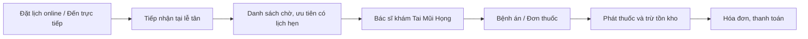
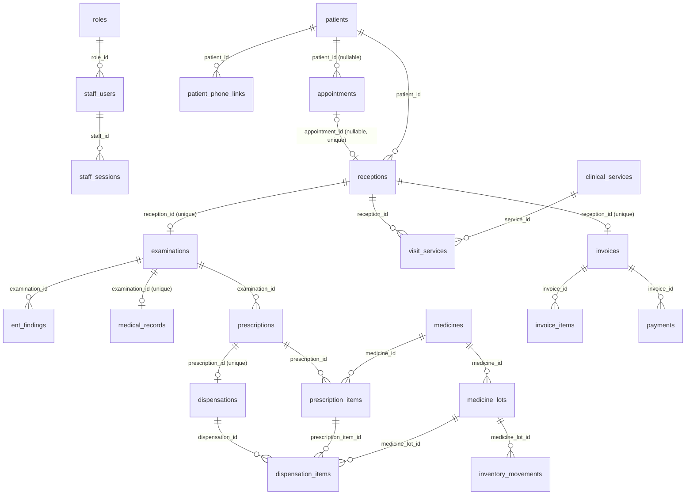

# ĐẶC TẢ CƠ SỞ DỮ LIỆU — HỆ THỐNG QUẢN LÝ PHÒNG KHÁM TAI MŨI HỌNG

> **Tài liệu phục vụ phát triển Backend ASP.NET Core Web API**  
> **Nguồn:** file T-SQL `Văn bản đã dán (1)(20261107-154609).txt` do người dùng cung cấp.  
> **Hệ quản trị:** Microsoft SQL Server (T-SQL) · **Database thực tế:** `clinic_managerment` · **Số bảng:** 25 · **Số cột:** 225.  
> **Trạng thái:** Đặc tả theo SQL được gửi, **không phải** kết quả kiểm tra trên SQL Server đang chạy. Tài liệu này **không sửa schema**.

## 0. Hướng dẫn sử dụng

Tài liệu thiết kế theo đúng ví dụ bạn yêu cầu: từng bảng có **mục đích → cột dữ liệu → trạng thái/giá trị → quan hệ → quy tắc nghiệp vụ → gợi ý Backend**. Các khóa/chỉ mục và kiểu dữ liệu trích từ T-SQL thực tế; mô tả nghiệp vụ và API là hướng dẫn triển khai, không phải endpoint đang chạy.

- **PK**: khóa chính; **FK**: khóa ngoại; **UNIQUE**: không trùng; **IDENTITY**: tự tăng; **Computed**: SQL Server tự tính.
- **NULL**: có thể bỏ trống; **NOT NULL**: bắt buộc; `SYSUTCDATETIME()` là thời gian UTC do SQL Server sinh.
- Ngày, giờ hẹn `appointment_date`/`appointment_time` theo giờ địa phương phòng khám; các cột audit thời gian được dùng theo UTC khi triển khai Backend.
- Tên bảng và truy vấn không dùng tiền tố `dbo.` theo yêu cầu. Trong SQL Server, schema mặc định của bảng vẫn tồn tại.
- Không có các bảng `clinic_rooms`, `room_assignments`, `inventory_receipts`, `inventory_receipt_items`, `patient_access_credentials`, `patient_history_access_grants` theo các quyết định đã chốt.

### Mục lục 25 bảng

01. [`roles`](#01-roles) — Vai trò nhân viên  
02. [`staff_users`](#02-staff-users) — Tài khoản nhân viên  
03. [`staff_sessions`](#03-staff-sessions) — Phiên đăng nhập nhân viên  
04. [`patients`](#04-patients) — Hồ sơ hành chính bệnh nhân  
05. [`patient_phone_links`](#05-patient-phone-links) — Số điện thoại liên kết bệnh nhân  
06. [`otp_challenges`](#06-otp-challenges) — Yêu cầu xác thực OTP  
07. [`appointments`](#07-appointments) — Lịch hẹn khám bệnh  
08. [`appointment_status_history`](#08-appointment-status-history) — Lịch sử trạng thái lịch hẹn  
09. [`receptions`](#09-receptions) — Lượt tiếp nhận bệnh nhân  
10. [`examinations`](#10-examinations) — Lượt khám của bác sĩ  
11. [`ent_findings`](#11-ent-findings) — Kết quả khám Tai Mũi Họng  
12. [`medical_records`](#12-medical-records) — Hồ sơ bệnh án  
13. [`medicines`](#13-medicines) — Danh mục thuốc  
14. [`medicine_lots`](#14-medicine-lots) — Lô thuốc và tồn kho  
15. [`medicine_suppliers`](#15-medicine-suppliers) — Nhà cung cấp thuốc  
16. [`inventory_movements`](#16-inventory-movements) — Lịch sử biến động kho  
17. [`prescriptions`](#17-prescriptions) — Đơn thuốc — thông tin chung  
18. [`prescription_items`](#18-prescription-items) — Thuốc trong đơn kê  
19. [`dispensations`](#19-dispensations) — Phiếu phát thuốc (header)  
20. [`dispensation_items`](#20-dispensation-items) — Chi tiết thuốc đã phát  
21. [`clinical_services`](#21-clinical-services) — Danh mục dịch vụ khám  
22. [`visit_services`](#22-visit-services) — Dịch vụ bệnh nhân sử dụng  
23. [`invoices`](#23-invoices) — Hóa đơn thanh toán  
24. [`invoice_items`](#24-invoice-items) — Chi tiết hóa đơn  
25. [`payments`](#25-payments) — Giao dịch thanh toán  

## 0.1. Luồng nghiệp vụ tổng quát



**Tác nhân:** Bệnh nhân (đặt lịch/OTP); Lễ tân (lịch hẹn, tiếp nhận, kho, phát thuốc, thanh toán); Bác sĩ (khám, bệnh án, kê đơn); Admin (tài khoản). Giao diện nhân viên dùng cổng đăng nhập chung.

## 0.2. Quan hệ chính giữa các bảng



**Lưu ý:** Sơ đồ trên tóm tắt quan hệ nghiệp vụ. Danh sách FK thực tế đầy đủ có tại từng bảng, kể cả các FK đến `staff_users`. Hai bảng `otp_challenges` và `medicine_suppliers` hiện độc lập về FK.

---

<a id="01-roles"></a>
## 01. `roles` — Vai trò nhân viên

**Use Case:** Đăng nhập; UC-13 — Quản lý tài khoản.

### 1. Mục đích

Danh mục ba nhóm nhân viên sử dụng cổng đăng nhập chung: quản trị viên, bác sĩ, lễ tân.

### 2. Thiết kế các cột

| Tên cột | Kiểu SQL Server | Bắt buộc | Mặc định / đặc điểm | Ý nghĩa |
|---|---|---|---|---|
| `id` | `BIGINT` | Có | `—` [PK, IDENTITY] | Khóa chính, định danh vai trò |
| `code` | `VARCHAR(20)` | Có | `—` [UNIQUE] | Mã vai trò dùng trong phân quyền |
| `name` | `NVARCHAR(80)` | Có | `—` | Tên hiển thị của vai trò |
| `description` | `NVARCHAR(255)` | Chưa ghi rõ | `—` | Mô tả phạm vi nhiệm vụ |

### 3. Các giá trị nghiệp vụ

**`code`**

| Giá trị | Ý nghĩa |
|---|---|
| `ADMIN` | Quản trị viên |
| `DOCTOR` | Bác sĩ |
| `RECEPTIONIST` | Lễ tân |

### 4. Quan hệ giữa các bảng

Bảng này không có khóa ngoại trong file SQL hiện tại.

**Các bảng tham chiếu đến bảng này:** `staff_users.role_id`.

### 5. Quy trình nghiệp vụ và quy tắc xử lý

**Luồng:** Admin tạo tài khoản → chọn một vai trò có trong `roles` → lưu `staff_users.role_id`.

- `code` duy nhất; dự kiến các mã `ADMIN`, `DOCTOR`, `RECEPTIONIST`.
- SQL hiện tại **chưa có lệnh INSERT** cho ba vai trò; cần seed dữ liệu có kiểm soát.
- Phân quyền API phải kiểm tra quyền thật ở Backend, không dựa vào tên menu.

### 6. Chỉ mục và ràng buộc từ SQL

- **UNIQUE:** `code`.

### 7. Gợi ý triển khai Backend ASP.NET Core

`GET /api/admin/roles` → danh sách vai trò; sử dụng làm lựa chọn trên form nhân viên.

**Kiểm tra bảng trên SQL Server:** `SELECT TOP (20) * FROM roles;`  
**Kiểm tra cấu trúc:** `EXEC sp_help 'roles';`

---

<a id="02-staff-users"></a>
## 02. `staff_users` — Tài khoản nhân viên

**Use Case:** UC-13 — Quản lý tài khoản; Đăng nhập.

### 1. Mục đích

Lưu tài khoản của Admin, bác sĩ và lễ tân; liên kết với vai trò để áp quyền.

### 2. Thiết kế các cột

| Tên cột | Kiểu SQL Server | Bắt buộc | Mặc định / đặc điểm | Ý nghĩa |
|---|---|---|---|---|
| `id` | `BIGINT` | Có | `—` [PK, IDENTITY] | Khóa chính tài khoản |
| `staff_code` | `VARCHAR(30)` | Có | `—` [UNIQUE] | Mã nhân viên nội bộ |
| `username` | `NVARCHAR(80)` | Có | `—` [UNIQUE] | Tên đăng nhập |
| `password_hash` | `NVARCHAR(500)` | Có | `—` | Giá trị băm mật khẩu (không phải mật khẩu gốc) |
| `full_name` | `NVARCHAR(150)` | Có | `—` | Họ tên nhân viên |
| `email` | `VARCHAR(254)` | Không | `—` | Địa chỉ thư điện tử |
| `phone` | `VARCHAR(20)` | Không | `—` | Số điện thoại liên hệ |
| `role_id` | `BIGINT` | Có | `—` [FK] | Vai trò đăng nhập |
| `license_number` | `NVARCHAR(80)` | Không | `—` | Số giấy phép/chứng chỉ hành nghề khi áp dụng |
| `status` | `VARCHAR(12)` | Có | `'ACTIVE'` | Trạng thái tài khoản |
| `last_login_at` | `DATETIME2(0)` | Không | `—` | Thời điểm đăng nhập gần nhất |
| `created_at` | `DATETIME2(0)` | Có | `SYSUTCDATETIME()` | Thời điểm tạo tài khoản |
| `updated_at` | `DATETIME2(0)` | Có | `SYSUTCDATETIME()` | Thời điểm cập nhật gần nhất |

### 3. Các giá trị nghiệp vụ

**`status`**

| Giá trị | Ý nghĩa |
|---|---|
| `ACTIVE` | Hoạt động |
| `LOCKED` | Bị khóa |
| `DISABLED` | Ngừng sử dụng |

### 4. Quan hệ giữa các bảng

| Cột FK | Bảng / cột tham chiếu | Quan hệ |
|---|---|---|
| `role_id` | `roles.id` | `roles` (1) → `staff_users` (N) |

**Các bảng tham chiếu đến bảng này:** `staff_sessions.staff_id`, `appointment_status_history.changed_by_staff_id`, `receptions.received_by_staff_id`, `examinations.doctor_staff_id`, `inventory_movements.performed_by_staff_id`, `prescriptions.doctor_staff_id`, `dispensations.dispensed_by_staff_id`, `invoices.created_by_staff_id`, `payments.received_by_staff_id`.

### 5. Quy trình nghiệp vụ và quy tắc xử lý

**Luồng:** Admin tạo tài khoản → gán `role_id` → nhân viên đăng nhập → Backend kiểm tra mật khẩu, trạng thái → cho phép vào khu vực đúng quyền.

- `staff_code`, `username` duy nhất; email và số giấy phép có **unique filtered index** khi khác NULL.
- `password_hash` do ASP.NET Core PasswordHasher (hoặc phương án tương đương) tạo, không nhận/trả trong DTO công khai.
- Tài khoản `LOCKED` hoặc `DISABLED` không được đăng nhập.
- `updated_at` không tự đổi khi UPDATE; Backend phải cập nhật.

### 6. Chỉ mục và ràng buộc từ SQL

- **UNIQUE:** `staff_code`, `username`.
- **FK:** `FK_staff_role`.
- **CHECK:** `CK_staff_status`.
- **UNIQUE INDEX:** `UX_staff_email` trên `(email)` — điều kiện `WHERE email IS NOT NULL`.
- **UNIQUE INDEX:** `UX_staff_license` trên `(license_number)` — điều kiện `WHERE license_number IS NOT NULL`.

### 7. Gợi ý triển khai Backend ASP.NET Core

`POST /api/staff/auth/login`; `GET/POST/PATCH /api/admin/staff`; riêng thao tác đổi mật khẩu.

**Kiểm tra bảng trên SQL Server:** `SELECT TOP (20) * FROM staff_users;`  
**Kiểm tra cấu trúc:** `EXEC sp_help 'staff_users';`

---

<a id="03-staff-sessions"></a>
## 03. `staff_sessions` — Phiên đăng nhập nhân viên

**Use Case:** Đăng nhập dùng chung.

### 1. Mục đích

Lưu Refresh Token được băm và thời hạn phiên đăng nhập của nhân viên.

### 2. Thiết kế các cột

| Tên cột | Kiểu SQL Server | Bắt buộc | Mặc định / đặc điểm | Ý nghĩa |
|---|---|---|---|---|
| `id` | `BIGINT` | Có | `—` [PK, IDENTITY] | Khóa chính phiên |
| `staff_id` | `BIGINT` | Có | `—` [FK] | Nhân viên sở hữu phiên |
| `refresh_token_hash` | `CHAR(64)` | Có | `—` [UNIQUE] | Băm token làm mới (không lưu token rõ) |
| `created_at` | `DATETIME2(0)` | Có | `SYSUTCDATETIME()` | Thời điểm khởi tạo |
| `expires_at` | `DATETIME2(0)` | Có | `—` | Thời điểm hết hạn |
| `revoked_at` | `DATETIME2(0)` | Không | `—` | Thời điểm thu hồi/đăng xuất |

### 3. Các giá trị nghiệp vụ

Bảng không có tập trạng thái nghiệp vụ riêng được liệt kê trong đặc tả hiện tại.

### 4. Quan hệ giữa các bảng

| Cột FK | Bảng / cột tham chiếu | Quan hệ |
|---|---|---|
| `staff_id` | `staff_users.id` | `staff_users` (1) → `staff_sessions` (N) |

### 5. Quy trình nghiệp vụ và quy tắc xử lý

**Luồng:** Đăng nhập thành công → cấp token → lưu hash vào bảng → làm mới token kiểm tra hạn/thu hồi → đăng xuất đặt `revoked_at`.

- Chỉ lưu hash token; không ghi token gốc hoặc hash mật khẩu vào log.
- Token hợp lệ nếu chưa hết hạn, chưa bị thu hồi và tài khoản vẫn `ACTIVE`.
- Thực hiện xoay vòng Refresh Token khi làm mới.

### 6. Chỉ mục và ràng buộc từ SQL

- **UNIQUE:** `refresh_token_hash`.
- **FK:** `FK_staff_sessions_staff`.
- **CHECK:** `CK_staff_sessions_expiry`, `CK_staff_sessions_revoked`.
- **INDEX:** `IX_staff_sessions_staff_expiry` trên `(staff_id, expires_at)`.

### 7. Gợi ý triển khai Backend ASP.NET Core

`POST /api/staff/auth/refresh`; `POST /api/staff/auth/logout`; middleware/authorization xác thực trên mỗi API.

**Kiểm tra bảng trên SQL Server:** `SELECT TOP (20) * FROM staff_sessions;`  
**Kiểm tra cấu trúc:** `EXEC sp_help 'staff_sessions';`

---

<a id="04-patients"></a>
## 04. `patients` — Hồ sơ hành chính bệnh nhân

**Use Case:** UC-02, UC-04, UC-07, UC-10, UC-11.

### 1. Mục đích

Lưu một hồ sơ hành chính cho mỗi bệnh nhân; mỗi người có thể đến khám nhiều lần.

### 2. Thiết kế các cột

| Tên cột | Kiểu SQL Server | Bắt buộc | Mặc định / đặc điểm | Ý nghĩa |
|---|---|---|---|---|
| `id` | `BIGINT` | Có | `—` [PK, IDENTITY] | Khóa chính bệnh nhân |
| `patient_code` | `VARCHAR(30)` | Có | `—` [UNIQUE] | Mã hồ sơ bệnh nhân |
| `full_name` | `NVARCHAR(150)` | Có | `—` | Họ tên bệnh nhân |
| `birth_date` | `DATE` | Không | `—` | Ngày sinh |
| `gender` | `VARCHAR(12)` | Có | `'UNSPECIFIED'` | Giới tính |
| `phone` | `VARCHAR(20)` | Không | `—` | Số điện thoại liên hệ trong hồ sơ |
| `address` | `NVARCHAR(500)` | Không | `—` | Địa chỉ |
| `occupation` | `NVARCHAR(120)` | Không | `—` | Nghề nghiệp |
| `insurance_number` | `VARCHAR(50)` | Không | `—` | Số thẻ BHYT nếu có |
| `allergy_notes` | `NVARCHAR(MAX)` | Không | `—` | Thông tin dị ứng được ghi nhận |
| `medical_history_notes` | `NVARCHAR(MAX)` | Không | `—` | Tiền sử bệnh được ghi nhận |
| `emergency_contact_name` | `NVARCHAR(150)` | Không | `—` | Họ tên người liên hệ khẩn cấp |
| `emergency_contact_phone` | `VARCHAR(20)` | Không | `—` | SĐT người liên hệ khẩn cấp |
| `created_at` | `DATETIME2(0)` | Có | `SYSUTCDATETIME()` | Thời điểm tạo hồ sơ |
| `updated_at` | `DATETIME2(0)` | Có | `SYSUTCDATETIME()` | Thời điểm cập nhật hồ sơ |

### 3. Các giá trị nghiệp vụ

**`gender`**

| Giá trị | Ý nghĩa |
|---|---|
| `MALE` | Nam |
| `FEMALE` | Nữ |
| `OTHER` | Khác |
| `UNSPECIFIED` | Chưa xác định |

### 4. Quan hệ giữa các bảng

Bảng này không có khóa ngoại trong file SQL hiện tại.

**Các bảng tham chiếu đến bảng này:** `patient_phone_links.patient_id`, `appointments.patient_id`, `receptions.patient_id`.

### 5. Quy trình nghiệp vụ và quy tắc xử lý

**Luồng:** Lễ tân tìm bệnh nhân theo tên/SĐT → nếu đã có thì dùng hồ sơ cũ → nếu chưa có thì tạo → sử dụng `patients.id` khi tiếp nhận.

- `patient_code` duy nhất; số điện thoại **không duy nhất** vì người nhà có thể dùng chung.
- Không nhầm bảng hành chính `patients` với kết quả khám hay bệnh án.
- SĐT đang có cả ở `patients.phone` và `patient_phone_links`; cần định rõ nơi ghi chính để tránh lệch.

### 6. Chỉ mục và ràng buộc từ SQL

- **UNIQUE:** `patient_code`.
- **CHECK:** `CK_patients_gender`.
- **INDEX:** `IX_patients_phone` trên `(phone)`.
- **INDEX:** `IX_patients_name_birth` trên `(full_name, birth_date)`.

### 7. Gợi ý triển khai Backend ASP.NET Core

`GET /api/receptionist/patients?keyword=...`; `POST /api/receptionist/patients`; `GET /api/receptionist/patients/{id}`.

**Kiểm tra bảng trên SQL Server:** `SELECT TOP (20) * FROM patients;`  
**Kiểm tra cấu trúc:** `EXEC sp_help 'patients';`

---

<a id="05-patient-phone-links"></a>
## 05. `patient_phone_links` — Số điện thoại liên kết bệnh nhân

**Use Case:** UC-02 — Tra cứu lịch sử khám; UC-04, UC-07.

### 1. Mục đích

Cho phép một SĐT liên kết nhiều bệnh nhân; một bệnh nhân có thể có nhiều SĐT liên hệ.

### 2. Thiết kế các cột

| Tên cột | Kiểu SQL Server | Bắt buộc | Mặc định / đặc điểm | Ý nghĩa |
|---|---|---|---|---|
| `id` | `BIGINT` | Có | `—` [PK, IDENTITY] | Khóa chính liên kết |
| `patient_id` | `BIGINT` | Có | `—` [FK] | Bệnh nhân được liên kết |
| `phone_e164` | `VARCHAR(16)` | Có | `—` | Số điện thoại chuẩn quốc tế |
| `relationship_to_patient` | `VARCHAR(20)` | Có | `'SELF'` | Mối quan hệ người giữ SĐT với bệnh nhân |
| `is_primary` | `BIT` | Có | `0` | Đánh dấu số liên hệ chính |
| `verified_at` | `DATETIME2(0)` | Không | `—` | Thời điểm số điện thoại được xác minh |
| `created_at` | `DATETIME2(0)` | Có | `SYSUTCDATETIME()` | Thời điểm tạo liên kết |

### 3. Các giá trị nghiệp vụ

**`relationship_to_patient`**

| Giá trị | Ý nghĩa |
|---|---|
| `SELF` | Chính bệnh nhân |
| `PARENT_GUARDIAN` | Cha/mẹ hoặc người giám hộ |
| `CAREGIVER` | Người chăm sóc |
| `OTHER` | Khác |

### 4. Quan hệ giữa các bảng

| Cột FK | Bảng / cột tham chiếu | Quan hệ |
|---|---|---|
| `patient_id` | `patients.id` | `patients` (1) → `patient_phone_links` (0..1) |

### 5. Quy trình nghiệp vụ và quy tắc xử lý

**Luồng:** Lễ tân gắn số liên hệ với bệnh nhân → tra cứu theo `phone_e164` tìm được các hồ sơ đã liên kết.

- Mỗi cặp (`patient_id`, `phone_e164`) không được trùng.
- Chỉ được tối đa **một số chính** (`is_primary=1`) cho mỗi bệnh nhân.
- Một SĐT có thể liên kết nhiều bệnh nhân; cần xác nhận quyền liên hệ/xem thông tin khi tạo liên kết.
- `phone_e164` dạng `+84...`; Backend chuẩn hóa trước khi lưu.

### 6. Chỉ mục và ràng buộc từ SQL

- **UNIQUE:** `UQ_patient_phone (constraint)`.
- **FK:** `FK_patient_phone_patient`.
- **CHECK:** `UQ_patient_phone`, `CK_patient_phone_relationship`, `CK_patient_phone_format`.
- **UNIQUE INDEX:** `UX_patient_primary_phone` trên `(patient_id)` — điều kiện `WHERE is_primary = 1`.
- **INDEX:** `IX_patient_phone_lookup` trên `(phone_e164, patient_id)`.

### 7. Gợi ý triển khai Backend ASP.NET Core

`GET /api/receptionist/patients/by-phone?phone=...` (nội bộ); dùng liên kết đã xác nhận cho chức năng tra cứu OTP.

**Kiểm tra bảng trên SQL Server:** `SELECT TOP (20) * FROM patient_phone_links;`  
**Kiểm tra cấu trúc:** `EXEC sp_help 'patient_phone_links';`

---

<a id="06-otp-challenges"></a>
## 06. `otp_challenges` — Yêu cầu xác thực OTP

**Use Case:** UC-02 — Tra cứu lịch sử khám.

### 1. Mục đích

Lưu yêu cầu OTP gửi tới SĐT để kiểm tra mã, giới hạn thời gian và số lần nhập sai.

### 2. Thiết kế các cột

| Tên cột | Kiểu SQL Server | Bắt buộc | Mặc định / đặc điểm | Ý nghĩa |
|---|---|---|---|---|
| `id` | `BIGINT` | Có | `—` [PK, IDENTITY] | Khóa chính yêu cầu OTP |
| `phone_e164` | `VARCHAR(16)` | Có | `—` | SĐT nhận mã |
| `purpose` | `VARCHAR(30)` | Có | `'HISTORY_LOOKUP'` | Mục đích phát hành OTP |
| `otp_hash` | `VARCHAR(255)` | Có | `—` | Giá trị băm/HMAC của OTP |
| `expires_at` | `DATETIME2(0)` | Có | `—` | Thời gian OTP hết hạn |
| `verified_at` | `DATETIME2(0)` | Không | `—` | Thời gian xác minh đúng |
| `consumed_at` | `DATETIME2(0)` | Không | `—` | Thời gian đã sử dụng và vô hiệu OTP |
| `attempt_count` | `TINYINT` | Có | `0` | Số lần thử đã ghi nhận |
| `max_attempts` | `TINYINT` | Có | `5` | Giới hạn số lần thử |
| `created_at` | `DATETIME2(0)` | Có | `SYSUTCDATETIME()` | Thời gian tạo OTP |

### 3. Các giá trị nghiệp vụ

**`purpose`**

| Giá trị | Ý nghĩa |
|---|---|
| `HISTORY_LOOKUP` | Xác thực tra cứu lịch sử khám |

### 4. Quan hệ giữa các bảng

Bảng này không có khóa ngoại trong file SQL hiện tại.

### 5. Quy trình nghiệp vụ và quy tắc xử lý

**Luồng:** Nhập SĐT → gửi SMS → xác thực OTP → chỉ hiển thị các hồ sơ gắn với số điện thoại đã xác minh.

- Không có bảng lưu phiên tra cứu lịch sử: **đây là thiết kế đã chốt**.
- `otp_hash` không lưu OTP rõ; giới hạn yêu cầu và số lần nhập tại Backend.
- Không thể chỉ nhận SĐT bất kỳ trong request trả bệnh án: Backend phải kiểm tra bằng chứng OTP hợp lệ cho từng lần/chuỗi truy cập.
- Không tự động công khai sự tồn tại của hồ sơ khi người dùng mới nhập SĐT.

### 6. Chỉ mục và ràng buộc từ SQL

- **CHECK:** `CK_otp_purpose`, `CK_otp_max_attempts`, `CK_otp_attempt_count`, `CK_otp_expiry`.
- **INDEX:** `IX_otp_phone_created` trên `(phone_e164, created_at)`.
- **INDEX:** `IX_otp_expires` trên `(expires_at)`.

### 7. Gợi ý triển khai Backend ASP.NET Core

`POST /api/public/history/send-otp`; `POST /api/public/history/verify-otp`; `GET /api/public/history` (yêu cầu bằng chứng OTP còn hiệu lực).

**Kiểm tra bảng trên SQL Server:** `SELECT TOP (20) * FROM otp_challenges;`  
**Kiểm tra cấu trúc:** `EXEC sp_help 'otp_challenges';`

---

<a id="07-appointments"></a>
## 07. `appointments` — Lịch hẹn khám bệnh

**Use Case:** UC-01 — Đặt lịch; UC-05 — Quản lý lịch hẹn.

### 1. Mục đích

Lưu lịch hẹn do bệnh nhân đặt công khai hoặc do lễ tân tạo, kể cả khi chưa có hồ sơ bệnh nhân.

### 2. Thiết kế các cột

| Tên cột | Kiểu SQL Server | Bắt buộc | Mặc định / đặc điểm | Ý nghĩa |
|---|---|---|---|---|
| `id` | `BIGINT` | Có | `—` [PK, IDENTITY] | Khóa chính lịch hẹn |
| `appointment_code` | `VARCHAR(30)` | Có | `—` [UNIQUE] | Mã lịch hẹn |
| `patient_id` | `BIGINT` | Không | `—` [FK] | Bệnh nhân liên kết, có thể chưa có khi đặt online |
| `full_name` | `NVARCHAR(150)` | Có | `—` | Họ tên người được khám |
| `phone` | `VARCHAR(20)` | Có | `—` | SĐT liên hệ |
| `birth_date` | `DATE` | Không | `—` | Ngày sinh người được khám |
| `gender` | `VARCHAR(12)` | Có | `'UNSPECIFIED'` | Giới tính |
| `appointment_date` | `DATE` | Có | `—` | Ngày hẹn |
| `appointment_time` | `TIME(0)` | Có | `—` | Giờ hẹn |
| `symptoms` | `NVARCHAR(MAX)` | Không | `—` | Triệu chứng người đặt lịch tự khai |
| `notes` | `NVARCHAR(500)` | Không | `—` | Ghi chú |
| `source` | `VARCHAR(20)` | Có | `'ONLINE'` | Nguồn tạo lịch |
| `status` | `VARCHAR(20)` | Có | `'PENDING'` | Trạng thái lịch hẹn |
| `created_at` | `DATETIME2(0)` | Có | `SYSUTCDATETIME()` | Thời gian đặt lịch |
| `updated_at` | `DATETIME2(0)` | Có | `SYSUTCDATETIME()` | Thời gian cập nhật |

### 3. Các giá trị nghiệp vụ

**`source`**

| Giá trị | Ý nghĩa |
|---|---|
| `ONLINE` | Đặt trên website |
| `PHONE` | Đặt qua điện thoại |
| `AT_DESK` | Đặt tại quầy |

**`status`**

| Giá trị | Ý nghĩa |
|---|---|
| `PENDING` | Chờ xác nhận |
| `CONFIRMED` | Đã xác nhận |
| `CHECKED_IN` | Đã tới |
| `CANCELLED` | Đã hủy |
| `NO_SHOW` | Không đến |

**`gender`**

| Giá trị | Ý nghĩa |
|---|---|
| `MALE` | Nam |
| `FEMALE` | Nữ |
| `OTHER` | Khác |
| `UNSPECIFIED` | Chưa xác định |

### 4. Quan hệ giữa các bảng

| Cột FK | Bảng / cột tham chiếu | Quan hệ |
|---|---|---|
| `patient_id` | `patients.id` | `patients` (1) → `appointments` (N) |

**Các bảng tham chiếu đến bảng này:** `appointment_status_history.appointment_id`, `receptions.appointment_id`.

### 5. Quy trình nghiệp vụ và quy tắc xử lý

**Luồng:** Bệnh nhân đặt lịch → `PENDING` → lễ tân xác nhận → `CONFIRMED` → bệnh nhân đến → `CHECKED_IN` → sinh lượt `receptions`.

- Không cần `patient_id` khi đặt online.
- Không đồng nghĩa đặt lịch là đã khám; chỉ người đến và được lễ tân tiếp nhận mới vào hàng đợi.
- Ngày + giờ là thời gian địa phương phòng khám (Asia/Ho_Chi_Minh), khác UTC ở các cột audit.
- Backend kiểm tra giờ làm việc, xung đột lịch và chống spam.

### 6. Chỉ mục và ràng buộc từ SQL

- **UNIQUE:** `appointment_code`.
- **FK:** `FK_appointments_patient`.
- **CHECK:** `CK_appointments_gender`, `CK_appointments_source`, `CK_appointments_status`.
- **INDEX:** `IX_appointments_date_status` trên `(appointment_date, status)`.
- **INDEX:** `IX_appointments_phone` trên `(phone)`.

### 7. Gợi ý triển khai Backend ASP.NET Core

`POST /api/public/appointments`; `GET/PATCH /api/receptionist/appointments`; `POST /api/receptionist/appointments/{id}/confirm`.

**Kiểm tra bảng trên SQL Server:** `SELECT TOP (20) * FROM appointments;`  
**Kiểm tra cấu trúc:** `EXEC sp_help 'appointments';`

---

<a id="08-appointment-status-history"></a>
## 08. `appointment_status_history` — Lịch sử trạng thái lịch hẹn

**Use Case:** UC-05 — Quản lý lịch hẹn.

### 1. Mục đích

Ghi từng lần thay đổi trạng thái lịch hẹn để biết thời gian, người thực hiện và lý do.

### 2. Thiết kế các cột

| Tên cột | Kiểu SQL Server | Bắt buộc | Mặc định / đặc điểm | Ý nghĩa |
|---|---|---|---|---|
| `id` | `BIGINT` | Có | `—` [PK, IDENTITY] | Khóa chính lịch sử |
| `appointment_id` | `BIGINT` | Có | `—` [FK] | Lịch hẹn bị thay đổi |
| `old_status` | `VARCHAR(20)` | Không | `—` | Trạng thái trước (có thể NULL lần đầu) |
| `new_status` | `VARCHAR(20)` | Có | `—` | Trạng thái sau |
| `changed_by_staff_id` | `BIGINT` | Không | `—` [FK] | Nhân viên thay đổi; NULL nếu hệ thống tự đổi |
| `reason` | `NVARCHAR(500)` | Không | `—` | Lý do thay đổi |
| `changed_at` | `DATETIME2(0)` | Có | `SYSUTCDATETIME()` | Thời gian thay đổi |

### 3. Các giá trị nghiệp vụ

**`old_status`**

| Giá trị | Ý nghĩa |
|---|---|
| `PENDING` | Chờ |
| `CONFIRMED` | Xác nhận |
| `CHECKED_IN` | Đã tới |
| `CANCELLED` | Hủy |
| `NO_SHOW` | Không tới |

**`new_status`**

| Giá trị | Ý nghĩa |
|---|---|
| `PENDING` | Chờ |
| `CONFIRMED` | Xác nhận |
| `CHECKED_IN` | Đã tới |
| `CANCELLED` | Hủy |
| `NO_SHOW` | Không tới |

### 4. Quan hệ giữa các bảng

| Cột FK | Bảng / cột tham chiếu | Quan hệ |
|---|---|---|
| `appointment_id` | `appointments.id` | `appointments` (1) → `appointment_status_history` (N) |
| `changed_by_staff_id` | `staff_users.id` | `staff_users` (1) → `appointment_status_history` (N) |

### 5. Quy trình nghiệp vụ và quy tắc xử lý

**Luồng:** Xác nhận/hủy/check-in lịch hẹn → UPDATE `appointments.status` + INSERT lịch sử trong cùng transaction.

- `old_status` và `new_status` chỉ thuộc tập trạng thái của `appointments`.
- Không thay đổi/xóa bản ghi lịch sử tùy tiện.
- Nếu tạo lịch trực tiếp thì có thể ghi bản ghi từ NULL → `PENDING`.

### 6. Chỉ mục và ràng buộc từ SQL

- **FK:** `FK_appointment_history_appointment`, `FK_appointment_history_staff`.
- **CHECK:** `CK_appointment_history_new_status`, `CK_appointment_history_old_status`.
- **INDEX:** `IX_appointment_history` trên `(appointment_id, changed_at)`.

### 7. Gợi ý triển khai Backend ASP.NET Core

Được ghi bởi service xử lý lịch hẹn; `GET /api/receptionist/appointments/{id}/history`.

**Kiểm tra bảng trên SQL Server:** `SELECT TOP (20) * FROM appointment_status_history;`  
**Kiểm tra cấu trúc:** `EXEC sp_help 'appointment_status_history';`

---

<a id="09-receptions"></a>
## 09. `receptions` — Lượt tiếp nhận bệnh nhân

**Use Case:** UC-04 — Tiếp nhận; UC-05 — Lịch hẹn.

### 1. Mục đích

Đưa bệnh nhân đã có mặt tại phòng khám vào danh sách chờ khám; phân biệt đặt lịch với đến trực tiếp.

### 2. Thiết kế các cột

| Tên cột | Kiểu SQL Server | Bắt buộc | Mặc định / đặc điểm | Ý nghĩa |
|---|---|---|---|---|
| `id` | `BIGINT` | Có | `—` [PK, IDENTITY] | Khóa chính lượt tiếp nhận |
| `reception_code` | `VARCHAR(30)` | Có | `—` [UNIQUE] | Mã tiếp nhận |
| `patient_id` | `BIGINT` | Có | `—` [FK] | Bệnh nhân đã có hồ sơ |
| `appointment_id` | `BIGINT` | Không | `—` [FK] | Lịch hẹn gốc, NULL khi đến trực tiếp |
| `received_by_staff_id` | `BIGINT` | Có | `—` [FK] | Lễ tân tiếp nhận |
| `reception_type` | `VARCHAR(20)` | Có | `—` | Hình thức đến khám |
| `status` | `VARCHAR(20)` | Có | `'WAITING'` | Trạng thái chờ/đang khám/hoàn tất |
| `received_at` | `DATETIME2(0)` | Có | `SYSUTCDATETIME()` | Thời điểm tiếp nhận |
| `notes` | `NVARCHAR(500)` | Không | `—` | Ghi chú tiếp nhận |

### 3. Các giá trị nghiệp vụ

**`reception_type`**

| Giá trị | Ý nghĩa |
|---|---|
| `APPOINTMENT` | Đã đặt lịch |
| `WALK_IN` | Đến trực tiếp |

**`status`**

| Giá trị | Ý nghĩa |
|---|---|
| `WAITING` | Đang chờ khám |
| `IN_EXAM` | Đang khám |
| `COMPLETED` | Đã hoàn tất khám |
| `CANCELLED` | Hủy lượt |

### 4. Quan hệ giữa các bảng

| Cột FK | Bảng / cột tham chiếu | Quan hệ |
|---|---|---|
| `patient_id` | `patients.id` | `patients` (1) → `receptions` (N) |
| `appointment_id` | `appointments.id` | `appointments` (1) → `receptions` (0..1) |
| `received_by_staff_id` | `staff_users.id` | `staff_users` (1) → `receptions` (N) |

**Các bảng tham chiếu đến bảng này:** `examinations.reception_id`, `visit_services.reception_id`, `invoices.reception_id`.

### 5. Quy trình nghiệp vụ và quy tắc xử lý

**Luồng:** Có lịch: tìm lịch → đối chiếu bệnh nhân → check-in → tạo `APPOINTMENT`; Không đặt trước: tạo/chọn hồ sơ → tạo `WALK_IN` → vào hàng chờ.

- `appointment_id` duy nhất khi khác NULL; một lịch không tiếp nhận hai lần.
- `APPOINTMENT` bắt buộc có `appointment_id`; `WALK_IN` bắt buộc NULL.
- **Ưu tiên:** người đã đặt lịch và có mặt đứng trước người đến trực tiếp; trong nhóm đặt lịch sắp theo ngày/giờ hẹn, trong nhóm trực tiếp theo `received_at`.
- Không có bảng phòng hoặc phân phòng theo quyết định của phòng khám.

### 6. Chỉ mục và ràng buộc từ SQL

- **UNIQUE:** `reception_code`.
- **FK:** `FK_receptions_patient`, `FK_receptions_appointment`, `FK_receptions_staff`.
- **CHECK:** `CK_receptions_type`, `CK_receptions_status`.
- **UNIQUE INDEX:** `UX_receptions_appointment` trên `(appointment_id)` — điều kiện `WHERE appointment_id IS NOT NULL`.
- **INDEX:** `IX_receptions_waiting` trên `(status, received_at)`.

### 7. Gợi ý triển khai Backend ASP.NET Core

`POST /api/receptionist/receptions`; `GET /api/doctor/queue`; `POST /api/receptionist/appointments/{id}/check-in`.

**Kiểm tra bảng trên SQL Server:** `SELECT TOP (20) * FROM receptions;`  
**Kiểm tra cấu trúc:** `EXEC sp_help 'receptions';`

---

<a id="10-examinations"></a>
## 10. `examinations` — Lượt khám của bác sĩ

**Use Case:** UC-10 — Khám Tai Mũi Họng.

### 1. Mục đích

Lưu thời điểm bác sĩ bắt đầu, kết thúc một lượt khám và liên kết đến lượt tiếp nhận.

### 2. Thiết kế các cột

| Tên cột | Kiểu SQL Server | Bắt buộc | Mặc định / đặc điểm | Ý nghĩa |
|---|---|---|---|---|
| `id` | `BIGINT` | Có | `—` [PK, IDENTITY] | Khóa chính lượt khám |
| `examination_code` | `VARCHAR(30)` | Có | `—` [UNIQUE] | Mã lượt khám |
| `reception_id` | `BIGINT` | Có | `—` [UNIQUE, FK] | Lượt tiếp nhận được khám |
| `doctor_staff_id` | `BIGINT` | Có | `—` [FK] | Bác sĩ phụ trách |
| `chief_complaint` | `NVARCHAR(MAX)` | Không | `—` | Lý do chính bệnh nhân đến khám |
| `status` | `VARCHAR(20)` | Có | `'IN_PROGRESS'` | Trạng thái lượt khám |
| `started_at` | `DATETIME2(0)` | Có | `SYSUTCDATETIME()` | Thời điểm bắt đầu |
| `completed_at` | `DATETIME2(0)` | Không | `—` | Thời điểm hoàn thành |

### 3. Các giá trị nghiệp vụ

**`status`**

| Giá trị | Ý nghĩa |
|---|---|
| `IN_PROGRESS` | Đang khám |
| `COMPLETED` | Hoàn thành |
| `CANCELLED` | Hủy |

### 4. Quan hệ giữa các bảng

| Cột FK | Bảng / cột tham chiếu | Quan hệ |
|---|---|---|
| `reception_id` | `receptions.id` | `receptions` (1) → `examinations` (0..1) |
| `doctor_staff_id` | `staff_users.id` | `staff_users` (1) → `examinations` (N) |

**Các bảng tham chiếu đến bảng này:** `ent_findings.examination_id`, `medical_records.examination_id`, `prescriptions.examination_id`.

### 5. Quy trình nghiệp vụ và quy tắc xử lý

**Luồng:** Bác sĩ chọn bệnh nhân đang chờ → tạo `examinations` + đổi `receptions.status=IN_EXAM` → nhập kết quả → hoàn thành khám.

- `reception_id` duy nhất: một lượt tiếp nhận có tối đa một lượt khám.
- Chỉ nhân viên vai trò DOCTOR được tạo/chốt khám.
- Bắt đầu/kết thúc và cập nhật trạng thái hàng chờ phải nhất quán trong transaction.

### 6. Chỉ mục và ràng buộc từ SQL

- **UNIQUE:** `examination_code`, `reception_id`.
- **FK:** `FK_examinations_reception`, `FK_examinations_doctor`.
- **CHECK:** `CK_examinations_status`, `CK_examinations_time`.
- **INDEX:** `IX_examinations_doctor_status` trên `(doctor_staff_id, status)`.

### 7. Gợi ý triển khai Backend ASP.NET Core

`POST /api/doctor/examinations/start`; `PATCH /api/doctor/examinations/{id}`; `POST /api/doctor/examinations/{id}/complete`.

**Kiểm tra bảng trên SQL Server:** `SELECT TOP (20) * FROM examinations;`  
**Kiểm tra cấu trúc:** `EXEC sp_help 'examinations';`

---

<a id="11-ent-findings"></a>
## 11. `ent_findings` — Kết quả khám Tai Mũi Họng

**Use Case:** UC-10 — Khám Tai Mũi Họng.

### 1. Mục đích

Lưu từng ghi nhận khi bác sĩ khám tai, mũi, họng hoặc vùng đầu cổ.

### 2. Thiết kế các cột

| Tên cột | Kiểu SQL Server | Bắt buộc | Mặc định / đặc điểm | Ý nghĩa |
|---|---|---|---|---|
| `id` | `BIGINT` | Có | `—` [PK, IDENTITY] | Khóa chính kết quả |
| `examination_id` | `BIGINT` | Có | `—` [FK] | Lượt khám liên quan |
| `region` | `VARCHAR(20)` | Có | `—` | Bộ phận được khám |
| `side` | `VARCHAR(20)` | Có | `'NA'` | Bên trái, phải, cả hai hoặc không áp dụng |
| `description` | `NVARCHAR(MAX)` | Có | `—` | Mô tả dấu hiệu, kết quả khám |
| `created_at` | `DATETIME2(0)` | Có | `SYSUTCDATETIME()` | Thời điểm ghi nhận |

### 3. Các giá trị nghiệp vụ

**`region`**

| Giá trị | Ý nghĩa |
|---|---|
| `EAR` | Tai |
| `NOSE` | Mũi |
| `THROAT` | Họng |
| `HEAD_NECK` | Đầu/cổ |

**`side`**

| Giá trị | Ý nghĩa |
|---|---|
| `LEFT` | Trái |
| `RIGHT` | Phải |
| `BOTH` | Hai bên |
| `NA` | Không áp dụng |

### 4. Quan hệ giữa các bảng

| Cột FK | Bảng / cột tham chiếu | Quan hệ |
|---|---|---|
| `examination_id` | `examinations.id` | `examinations` (1) → `ent_findings` (N) |

### 5. Quy trình nghiệp vụ và quy tắc xử lý

**Luồng:** Bác sĩ vào phiếu khám → chọn bộ phận/vị trí → nhập mô tả → tạo một dòng `ent_findings` cho mỗi kết quả.

- Không buộc mỗi lượt khám có đủ tất cả bộ phận; có thể nhiều kết quả trong một bộ phận.
- `ent_findings` là **khám thực thể**, không thay cho chẩn đoán trong `medical_records`.
- Không có bảng nội soi, file ảnh theo thiết kế đã chốt hiện tại.

### 6. Chỉ mục và ràng buộc từ SQL

- **FK:** `FK_ent_findings_examination`.
- **CHECK:** `CK_ent_findings_region`, `CK_ent_findings_side`.
- **INDEX:** `IX_ent_findings_examination` trên `(examination_id)`.

### 7. Gợi ý triển khai Backend ASP.NET Core

`GET/POST /api/doctor/examinations/{id}/findings`; cần kiểm tra bác sĩ sở hữu lượt khám.

**Kiểm tra bảng trên SQL Server:** `SELECT TOP (20) * FROM ent_findings;`  
**Kiểm tra cấu trúc:** `EXEC sp_help 'ent_findings';`

---

<a id="12-medical-records"></a>
## 12. `medical_records` — Hồ sơ bệnh án

**Use Case:** UC-11 — Lập bệnh án; UC-02 — Tra cứu lịch sử.

### 1. Mục đích

Lưu chẩn đoán, kết luận, phương án điều trị và hướng dẫn tái khám cho một lượt khám.

### 2. Thiết kế các cột

| Tên cột | Kiểu SQL Server | Bắt buộc | Mặc định / đặc điểm | Ý nghĩa |
|---|---|---|---|---|
| `id` | `BIGINT` | Có | `—` [PK, IDENTITY] | Khóa chính bệnh án |
| `medical_record_code` | `VARCHAR(30)` | Có | `—` [UNIQUE] | Mã bệnh án |
| `examination_id` | `BIGINT` | Có | `—` [UNIQUE, FK] | Lượt khám được lập bệnh án |
| `diagnosis` | `NVARCHAR(500)` | Không | `—` | Chẩn đoán của bác sĩ |
| `conclusion` | `NVARCHAR(MAX)` | Không | `—` | Kết luận chuyên môn |
| `treatment_plan` | `NVARCHAR(MAX)` | Không | `—` | Phương án điều trị |
| `doctor_advice` | `NVARCHAR(MAX)` | Không | `—` | Lời dặn người bệnh |
| `follow_up_date` | `DATE` | Không | `—` | Ngày tái khám nếu có |
| `status` | `VARCHAR(15)` | Có | `'DRAFT'` | Trạng thái nháp/hoàn tất |
| `finalized_at` | `DATETIME2(0)` | Không | `—` | Thời điểm bác sĩ chốt |
| `created_at` | `DATETIME2(0)` | Có | `SYSUTCDATETIME()` | Thời gian tạo |
| `updated_at` | `DATETIME2(0)` | Có | `SYSUTCDATETIME()` | Thời gian sửa gần nhất |

### 3. Các giá trị nghiệp vụ

**`status`**

| Giá trị | Ý nghĩa |
|---|---|
| `DRAFT` | Bản nháp |
| `FINALIZED` | Đã hoàn tất |

### 4. Quan hệ giữa các bảng

| Cột FK | Bảng / cột tham chiếu | Quan hệ |
|---|---|---|
| `examination_id` | `examinations.id` | `examinations` (1) → `medical_records` (0..1) |

### 5. Quy trình nghiệp vụ và quy tắc xử lý

**Luồng:** Bác sĩ khám → tạo bệnh án nháp `DRAFT` → nhập chẩn đoán/kết luận → chốt `FINALIZED` + `finalized_at`.

- `examination_id` duy nhất: mỗi lượt khám có tối đa một bệnh án.
- Khi đã `FINALIZED`, không cho sửa im lặng; cần quy trình điều chỉnh và ghi nhận lịch sử nếu mở rộng.
- Không cần lưu `patient_id` hoặc `doctor_staff_id` trùng vì suy ra qua `examinations` → `receptions`.

### 6. Chỉ mục và ràng buộc từ SQL

- **UNIQUE:** `medical_record_code`, `examination_id`.
- **FK:** `FK_medical_records_examination`.
- **CHECK:** `CK_medical_records_status`, `CK_medical_records_finalized`.

### 7. Gợi ý triển khai Backend ASP.NET Core

`POST/PATCH /api/doctor/examinations/{id}/medical-record`; `POST .../finalize`; truy vấn bệnh sử phải kiểm soát truy cập.

**Kiểm tra bảng trên SQL Server:** `SELECT TOP (20) * FROM medical_records;`  
**Kiểm tra cấu trúc:** `EXEC sp_help 'medical_records';`

---

<a id="13-medicines"></a>
## 13. `medicines` — Danh mục thuốc

**Use Case:** UC-03 — Quản lý kho; UC-12 — Kê đơn; UC-08 — Phát thuốc.

### 1. Mục đích

Danh mục thuốc được kê đơn và bán tại phòng khám; không chứa tồn kho theo lô.

### 2. Thiết kế các cột

| Tên cột | Kiểu SQL Server | Bắt buộc | Mặc định / đặc điểm | Ý nghĩa |
|---|---|---|---|---|
| `id` | `BIGINT` | Có | `—` [PK, IDENTITY] | Khóa chính thuốc |
| `medicine_code` | `VARCHAR(30)` | Có | `—` [UNIQUE] | Mã danh mục thuốc |
| `medicine_name` | `NVARCHAR(200)` | Có | `—` | Tên thuốc |
| `active_ingredient` | `NVARCHAR(250)` | Không | `—` | Hoạt chất |
| `strength` | `NVARCHAR(100)` | Không | `—` | Hàm lượng/nồng độ |
| `dosage_form` | `NVARCHAR(100)` | Không | `—` | Dạng bào chế |
| `unit` | `NVARCHAR(50)` | Có | `—` | Đơn vị cấp phát (viên/chai/...) |
| `sale_price` | `DECIMAL(15,2)` | Có | `0` | Đơn giá bán mặc định |
| `status` | `VARCHAR(10)` | Có | `'ACTIVE'` | Đang sử dụng hoặc ngừng sử dụng |
| `notes` | `NVARCHAR(500)` | Không | `—` | Ghi chú |
| `created_at` | `DATETIME2(0)` | Có | `SYSUTCDATETIME()` | Ngày tạo danh mục |
| `updated_at` | `DATETIME2(0)` | Có | `SYSUTCDATETIME()` | Ngày sửa danh mục |

### 3. Các giá trị nghiệp vụ

**`status`**

| Giá trị | Ý nghĩa |
|---|---|
| `ACTIVE` | Đang sử dụng |
| `INACTIVE` | Ngừng sử dụng |

### 4. Quan hệ giữa các bảng

Bảng này không có khóa ngoại trong file SQL hiện tại.

**Các bảng tham chiếu đến bảng này:** `medicine_lots.medicine_id`, `prescription_items.medicine_id`.

### 5. Quy trình nghiệp vụ và quy tắc xử lý

**Luồng:** Nhân viên cập nhật danh mục → bác sĩ tìm thuốc đang `ACTIVE` để kê → lễ tân dùng danh mục kết hợp lô để phát.

- `medicine_code` duy nhất.
- Không trừ tồn kho ở bảng này; tồn theo `medicine_lots`.
- Giá đơn thuốc/hóa đơn tại thời điểm phát cần lưu ở bảng chi tiết để không thay đổi theo giá danh mục.

### 6. Chỉ mục và ràng buộc từ SQL

- **UNIQUE:** `medicine_code`.
- **CHECK:** `CK_medicines_price`, `CK_medicines_status`.
- **INDEX:** `IX_medicines_name` trên `(medicine_name)`.

### 7. Gợi ý triển khai Backend ASP.NET Core

`GET /api/doctor/medicines?keyword=...`; `GET/POST/PATCH /api/receptionist/medicines` (quyền quản lý kho theo quyết định phân quyền).

**Kiểm tra bảng trên SQL Server:** `SELECT TOP (20) * FROM medicines;`  
**Kiểm tra cấu trúc:** `EXEC sp_help 'medicines';`

---

<a id="14-medicine-lots"></a>
## 14. `medicine_lots` — Lô thuốc và tồn kho

**Use Case:** UC-03 — Kho; UC-08 — Phát thuốc.

### 1. Mục đích

Lưu tồn theo từng số lô và hạn sử dụng của một loại thuốc.

### 2. Thiết kế các cột

| Tên cột | Kiểu SQL Server | Bắt buộc | Mặc định / đặc điểm | Ý nghĩa |
|---|---|---|---|---|
| `id` | `BIGINT` | Có | `—` [PK, IDENTITY] | Khóa chính lô thuốc |
| `medicine_id` | `BIGINT` | Có | `—` [FK] | Thuốc thuộc lô |
| `lot_number` | `VARCHAR(100)` | Có | `—` | Số lô nhà sản xuất |
| `expiry_date` | `DATE` | Có | `—` | Ngày hết hạn |
| `quantity` | `DECIMAL(15,3)` | Có | `0` | Số lượng còn lại trong lô |
| `status` | `VARCHAR(15)` | Có | `'AVAILABLE'` | Tình trạng cho phép phát |
| `created_at` | `DATETIME2(0)` | Có | `SYSUTCDATETIME()` | Thời gian tạo bản ghi lô |

### 3. Các giá trị nghiệp vụ

**`status`**

| Giá trị | Ý nghĩa |
|---|---|
| `AVAILABLE` | Được sử dụng nếu còn hạn |
| `BLOCKED` | Khóa lô |
| `QUARANTINED` | Tạm giữ kiểm tra |

### 4. Quan hệ giữa các bảng

| Cột FK | Bảng / cột tham chiếu | Quan hệ |
|---|---|---|
| `medicine_id` | `medicines.id` | `medicines` (1) → `medicine_lots` (N) |

**Các bảng tham chiếu đến bảng này:** `inventory_movements.medicine_lot_id`, `dispensation_items.medicine_lot_id`.

### 5. Quy trình nghiệp vụ và quy tắc xử lý

**Luồng:** Nhập thuốc trên phiếu giấy → nhân viên ghi tăng số lượng theo lô → phát thuốc chọn lô còn hạn còn tồn → trừ tồn.

- Tổ hợp (`medicine_id`, `lot_number`, `expiry_date`) duy nhất.
- `quantity >= 0`; cập nhật đồng thời với `inventory_movements`.
- Lô `BLOCKED`/`QUARANTINED` hoặc hết hạn không được phát.
- Ưu tiên lô hết hạn sớm hơn nhưng vẫn đủ điều kiện (FEFO) khi chọn thuốc.

### 6. Chỉ mục và ràng buộc từ SQL

- **UNIQUE:** `UQ_medicine_lots (constraint)`.
- **FK:** `FK_medicine_lots_medicine`.
- **CHECK:** `UQ_medicine_lots`, `CK_medicine_lots_quantity`, `CK_medicine_lots_status`.
- **INDEX:** `IX_medicine_lots_expiry` trên `(expiry_date, status)`.

### 7. Gợi ý triển khai Backend ASP.NET Core

`GET /api/receptionist/inventory/lots`; `POST /api/receptionist/inventory/lots` (đăng ký lô), cập nhật số lượng qua nghiệp vụ biến động chứ không PATCH số lượng tùy tiện.

**Kiểm tra bảng trên SQL Server:** `SELECT TOP (20) * FROM medicine_lots;`  
**Kiểm tra cấu trúc:** `EXEC sp_help 'medicine_lots';`

---

<a id="15-medicine-suppliers"></a>
## 15. `medicine_suppliers` — Nhà cung cấp thuốc

**Use Case:** UC-03 — Quản lý kho.

### 1. Mục đích

Danh mục nhà cung cấp thuốc để tra cứu thông tin liên hệ; không gắn phiếu nhập điện tử.

### 2. Thiết kế các cột

| Tên cột | Kiểu SQL Server | Bắt buộc | Mặc định / đặc điểm | Ý nghĩa |
|---|---|---|---|---|
| `id` | `BIGINT` | Có | `—` [PK, IDENTITY] | Khóa chính nhà cung cấp |
| `supplier_code` | `VARCHAR(30)` | Có | `—` [UNIQUE] | Mã nhà cung cấp |
| `supplier_name` | `NVARCHAR(200)` | Có | `—` | Tên nhà cung cấp |
| `phone` | `VARCHAR(20)` | Không | `—` | Số điện thoại |
| `email` | `VARCHAR(254)` | Không | `—` | Email |
| `address` | `NVARCHAR(500)` | Không | `—` | Địa chỉ |
| `tax_code` | `VARCHAR(30)` | Không | `—` | Mã số thuế |
| `status` | `VARCHAR(10)` | Có | `'ACTIVE'` | Trạng thái hợp tác |
| `created_at` | `DATETIME2(0)` | Có | `SYSUTCDATETIME()` | Ngày tạo |

### 3. Các giá trị nghiệp vụ

**`status`**

| Giá trị | Ý nghĩa |
|---|---|
| `ACTIVE` | Đang hợp tác |
| `INACTIVE` | Ngừng hợp tác |

### 4. Quan hệ giữa các bảng

Bảng này không có khóa ngoại trong file SQL hiện tại.

### 5. Quy trình nghiệp vụ và quy tắc xử lý

**Luồng:** Nhân viên lưu thông tin nhà cung cấp để tra cứu khi mua và nhận thuốc bằng phiếu giấy.

- `supplier_code` duy nhất.
- **Không có bảng phiếu nhập**; việc nhập hàng dùng chứng từ giấy như đã thống nhất.
- Bảng này hiện chưa có FK từ bảng khác trong file SQL; nếu chỉ cần tối giản và không tra cứu NCC, có thể xem xét khi rà soát.

### 6. Chỉ mục và ràng buộc từ SQL

- **UNIQUE:** `supplier_code`.
- **CHECK:** `CK_medicine_suppliers_status`.

### 7. Gợi ý triển khai Backend ASP.NET Core

`GET/POST/PATCH /api/receptionist/inventory/suppliers` nếu giao diện cần quản lý nhà cung cấp.

**Kiểm tra bảng trên SQL Server:** `SELECT TOP (20) * FROM medicine_suppliers;`  
**Kiểm tra cấu trúc:** `EXEC sp_help 'medicine_suppliers';`

---

<a id="16-inventory-movements"></a>
## 16. `inventory_movements` — Lịch sử biến động kho

**Use Case:** UC-03 — Quản lý kho; UC-08 — Phát thuốc.

### 1. Mục đích

Lưu lịch sử tăng/giảm số lượng từng lô thuốc mà không cần quản lý phiếu nhập điện tử.

### 2. Thiết kế các cột

| Tên cột | Kiểu SQL Server | Bắt buộc | Mặc định / đặc điểm | Ý nghĩa |
|---|---|---|---|---|
| `id` | `BIGINT` | Có | `—` [PK, IDENTITY] | Khóa chính giao dịch kho |
| `medicine_lot_id` | `BIGINT` | Có | `—` [FK] | Lô thuốc thay đổi |
| `movement_type` | `VARCHAR(15)` | Có | `—` | Loại nhập/xuất/điều chỉnh |
| `quantity_change` | `DECIMAL(15,3)` | Có | `—` | Lượng chênh lệch có dấu (+ hoặc -) |
| `performed_by_staff_id` | `BIGINT` | Có | `—` [FK] | Nhân viên thực hiện |
| `notes` | `NVARCHAR(500)` | Không | `—` | Ghi chú/lý do |
| `created_at` | `DATETIME2(0)` | Có | `SYSUTCDATETIME()` | Thời điểm biến động |

### 3. Các giá trị nghiệp vụ

**`movement_type`**

| Giá trị | Ý nghĩa |
|---|---|
| `IN` | Nhập (+) |
| `OUT` | Xuất (-) |
| `ADJUSTMENT` | Điều chỉnh (+/-) |

### 4. Quan hệ giữa các bảng

| Cột FK | Bảng / cột tham chiếu | Quan hệ |
|---|---|---|
| `medicine_lot_id` | `medicine_lots.id` | `medicine_lots` (1) → `inventory_movements` (N) |
| `performed_by_staff_id` | `staff_users.id` | `staff_users` (1) → `inventory_movements` (N) |

### 5. Quy trình nghiệp vụ và quy tắc xử lý

**Luồng:** Nhập thủ công sau ký phiếu giấy → `IN` (+); phát thuốc → `OUT` (-); kiểm kê chênh lệch → `ADJUSTMENT` (+/-).

- `IN` phải có lượng dương; `OUT` lượng âm; `ADJUSTMENT` khác 0.
- Cập nhật `medicine_lots.quantity` và chèn lịch sử trong **cùng transaction**.
- Không để tồn âm, chống hai yêu cầu cùng xuất vượt tồn.
- Hiện `inventory_movements` chưa có FK đến `dispensation_items`; Backend phải tạo bản ghi kho và chống ghi trùng khi phát thuốc.

### 6. Chỉ mục và ràng buộc từ SQL

- **FK:** `FK_inventory_movements_lot`, `FK_inventory_movements_staff`.
- **CHECK:** `CK_inventory_movements_type`, `CK_inventory_movements_quantity`.
- **INDEX:** `IX_inventory_movements_lot` trên `(medicine_lot_id, created_at)`.

### 7. Gợi ý triển khai Backend ASP.NET Core

`POST /api/receptionist/inventory/adjustments`; `GET /api/receptionist/inventory/movements`.

**Kiểm tra bảng trên SQL Server:** `SELECT TOP (20) * FROM inventory_movements;`  
**Kiểm tra cấu trúc:** `EXEC sp_help 'inventory_movements';`

---

<a id="17-prescriptions"></a>
## 17. `prescriptions` — Đơn thuốc — thông tin chung

**Use Case:** UC-12 — Bác sĩ kê đơn; UC-08 — Phát thuốc.

### 1. Mục đích

Lưu đầu đơn thuốc bác sĩ lập cho một lượt khám; từng thuốc lưu ở `prescription_items`.

### 2. Thiết kế các cột

| Tên cột | Kiểu SQL Server | Bắt buộc | Mặc định / đặc điểm | Ý nghĩa |
|---|---|---|---|---|
| `id` | `BIGINT` | Có | `—` [PK, IDENTITY] | Khóa chính đơn |
| `prescription_code` | `VARCHAR(30)` | Có | `—` [UNIQUE] | Mã đơn thuốc |
| `examination_id` | `BIGINT` | Có | `—` [FK] | Lượt khám |
| `doctor_staff_id` | `BIGINT` | Có | `—` [FK] | Bác sĩ kê đơn |
| `status` | `VARCHAR(15)` | Có | `'DRAFT'` | Trạng thái nháp, đã xác nhận hoặc hủy |
| `instructions` | `NVARCHAR(MAX)` | Không | `—` | Hướng dẫn sử dụng chung |
| `created_at` | `DATETIME2(0)` | Có | `SYSUTCDATETIME()` | Thời gian tạo đơn |
| `signed_at` | `DATETIME2(0)` | Không | `—` | Thời gian bác sĩ xác nhận đơn |
| `updated_at` | `DATETIME2(0)` | Có | `SYSUTCDATETIME()` | Thời gian chỉnh sửa |

### 3. Các giá trị nghiệp vụ

**`status`**

| Giá trị | Ý nghĩa |
|---|---|
| `DRAFT` | Đang kê |
| `SIGNED` | Bác sĩ đã xác nhận |
| `CANCELLED` | Đã hủy |

### 4. Quan hệ giữa các bảng

| Cột FK | Bảng / cột tham chiếu | Quan hệ |
|---|---|---|
| `examination_id` | `examinations.id` | `examinations` (1) → `prescriptions` (N) |
| `doctor_staff_id` | `staff_users.id` | `staff_users` (1) → `prescriptions` (N) |

**Các bảng tham chiếu đến bảng này:** `prescription_items.prescription_id`, `dispensations.prescription_id`.

### 5. Quy trình nghiệp vụ và quy tắc xử lý

**Luồng:** Bác sĩ tạo `DRAFT` → nhập danh sách thuốc → xác nhận `SIGNED` → lễ tân phát theo đơn; nếu hủy thì `CANCELLED`.

- Chỉ đơn `SIGNED` mới được phát.
- Chỉ sửa các dòng của đơn `DRAFT`; đơn đã xác nhận cần quy trình hủy/thay thế.
- `doctor_staff_id` phải thuộc tài khoản bác sĩ; FK tự thân chưa kiểm soát vai trò.
- Trong SQL hiện tại, `signed_at` có thể còn giá trị khi `status=CANCELLED`; cần quyết định giữ dấu vết ký hay xóa khi hủy (khuyến nghị giữ dấu vết).

### 6. Chỉ mục và ràng buộc từ SQL

- **UNIQUE:** `prescription_code`.
- **FK:** `FK_prescriptions_examination`, `FK_prescriptions_doctor`.
- **CHECK:** `CK_prescriptions_status`, `CK_prescriptions_signed`.
- **INDEX:** `IX_prescriptions_examination` trên `(examination_id)`.

### 7. Gợi ý triển khai Backend ASP.NET Core

`POST /api/doctor/examinations/{id}/prescriptions`; `POST /api/doctor/prescriptions/{id}/sign`; `POST .../cancel`.

**Kiểm tra bảng trên SQL Server:** `SELECT TOP (20) * FROM prescriptions;`  
**Kiểm tra cấu trúc:** `EXEC sp_help 'prescriptions';`

---

<a id="18-prescription-items"></a>
## 18. `prescription_items` — Thuốc trong đơn kê

**Use Case:** UC-12 — Kê đơn; UC-08 — Phát thuốc.

### 1. Mục đích

Lưu mỗi dòng thuốc được bác sĩ kê cùng liều và tổng số lượng.

### 2. Thiết kế các cột

| Tên cột | Kiểu SQL Server | Bắt buộc | Mặc định / đặc điểm | Ý nghĩa |
|---|---|---|---|---|
| `id` | `BIGINT` | Có | `—` [PK, IDENTITY] | Khóa chính dòng thuốc |
| `prescription_id` | `BIGINT` | Có | `—` [FK] | Đơn thuốc chứa dòng này |
| `medicine_id` | `BIGINT` | Có | `—` [FK] | Thuốc trong danh mục |
| `dosage` | `NVARCHAR(100)` | Có | `—` | Liều lượng mỗi lần dùng |
| `frequency` | `NVARCHAR(100)` | Có | `—` | Tần suất dùng |
| `duration_days` | `INT` | Không | `—` | Số ngày sử dụng (nếu có) |
| `quantity` | `DECIMAL(15,3)` | Có | `—` | Tổng số lượng được kê |
| `instructions` | `NVARCHAR(500)` | Không | `—` | Hướng dẫn dùng chi tiết |
| `created_at` | `DATETIME2(0)` | Có | `SYSUTCDATETIME()` | Ngày thêm dòng thuốc |

### 3. Các giá trị nghiệp vụ

Bảng không có tập trạng thái nghiệp vụ riêng được liệt kê trong đặc tả hiện tại.

### 4. Quan hệ giữa các bảng

| Cột FK | Bảng / cột tham chiếu | Quan hệ |
|---|---|---|
| `prescription_id` | `prescriptions.id` | `prescriptions` (1) → `prescription_items` (N) |
| `medicine_id` | `medicines.id` | `medicines` (1) → `prescription_items` (N) |

**Các bảng tham chiếu đến bảng này:** `dispensation_items.prescription_item_id`.

### 5. Quy trình nghiệp vụ và quy tắc xử lý

**Luồng:** Bác sĩ tìm thuốc → điền liều, tần suất, ngày dùng, số lượng → lưu dòng trong đơn nháp.

- `quantity > 0`; nếu có `duration_days` thì phải >0.
- Đơn đã ký không được sửa dòng thuốc.
- Một thuốc có thể có nhiều dòng trong đơn nếu hướng dẫn khác nhau.
- Không trừ kho khi thêm dòng kê.

### 6. Chỉ mục và ràng buộc từ SQL

- **FK:** `FK_prescription_items_prescription`, `FK_prescription_items_medicine`.
- **CHECK:** `CK_prescription_items_quantity`, `CK_prescription_items_duration`.
- **INDEX:** `IX_prescription_items_prescription` trên `(prescription_id)`.

### 7. Gợi ý triển khai Backend ASP.NET Core

`POST/PATCH/DELETE /api/doctor/prescriptions/{id}/items` khi đơn ở `DRAFT`.

**Kiểm tra bảng trên SQL Server:** `SELECT TOP (20) * FROM prescription_items;`  
**Kiểm tra cấu trúc:** `EXEC sp_help 'prescription_items';`

---

<a id="19-dispensations"></a>
## 19. `dispensations` — Phiếu phát thuốc (header)

**Use Case:** UC-08 — Lễ tân phát thuốc.

### 1. Mục đích

Lưu lần phát thuốc ứng với một đơn đã ký, ai phát và đã phát hay chưa.

### 2. Thiết kế các cột

| Tên cột | Kiểu SQL Server | Bắt buộc | Mặc định / đặc điểm | Ý nghĩa |
|---|---|---|---|---|
| `id` | `BIGINT` | Có | `—` [PK, IDENTITY] | Khóa chính lần phát |
| `dispensation_code` | `VARCHAR(30)` | Có | `—` [UNIQUE] | Mã phát thuốc |
| `prescription_id` | `BIGINT` | Có | `—` [UNIQUE, FK] | Đơn thuốc được phát |
| `dispensed_by_staff_id` | `BIGINT` | Có | `—` [FK] | Nhân viên thực hiện phát |
| `status` | `VARCHAR(15)` | Có | `'PENDING'` | Chưa phát, hoàn thành hoặc hủy |
| `dispensed_at` | `DATETIME2(0)` | Không | `—` | Thời gian hoàn tất phát |
| `notes` | `NVARCHAR(500)` | Không | `—` | Ghi chú |
| `created_at` | `DATETIME2(0)` | Có | `SYSUTCDATETIME()` | Thời gian lập |

### 3. Các giá trị nghiệp vụ

**`status`**

| Giá trị | Ý nghĩa |
|---|---|
| `PENDING` | Chưa phát |
| `COMPLETED` | Đã phát |
| `CANCELLED` | Hủy |

### 4. Quan hệ giữa các bảng

| Cột FK | Bảng / cột tham chiếu | Quan hệ |
|---|---|---|
| `prescription_id` | `prescriptions.id` | `prescriptions` (1) → `dispensations` (0..1) |
| `dispensed_by_staff_id` | `staff_users.id` | `staff_users` (1) → `dispensations` (N) |

**Các bảng tham chiếu đến bảng này:** `dispensation_items.dispensation_id`.

### 5. Quy trình nghiệp vụ và quy tắc xử lý

**Luồng:** Đơn `SIGNED` → tạo phát thuốc `PENDING` → chọn lô/số lượng ở `dispensation_items` → xác nhận `COMPLETED` → cập nhật tồn kho.

- `prescription_id` duy nhất: thiết kế chỉ phát **một lần trọn đơn**, chưa hỗ trợ phát nhiều đợt.
- Chỉ `COMPLETED` mới có `dispensed_at`.
- Không phát lại đơn đã hoàn thành.
- Trạng thái, trừ tồn và lịch sử kho cần transaction chung.

### 6. Chỉ mục và ràng buộc từ SQL

- **UNIQUE:** `dispensation_code`, `prescription_id`.
- **FK:** `FK_dispensations_prescription`, `FK_dispensations_staff`.
- **CHECK:** `CK_dispensations_status`, `CK_dispensations_completed`.
- **INDEX:** `IX_dispensations_status` trên `(status, created_at)`.

### 7. Gợi ý triển khai Backend ASP.NET Core

`POST /api/receptionist/dispensations`; `POST /api/receptionist/dispensations/{id}/complete`.

**Kiểm tra bảng trên SQL Server:** `SELECT TOP (20) * FROM dispensations;`  
**Kiểm tra cấu trúc:** `EXEC sp_help 'dispensations';`

---

<a id="20-dispensation-items"></a>
## 20. `dispensation_items` — Chi tiết thuốc đã phát

**Use Case:** UC-08 — Phát thuốc; UC-03 — Kho.

### 1. Mục đích

Lưu số lượng và đơn giá thuốc thực tế phát theo từng lô, đối chiếu với đơn bác sĩ kê.

### 2. Thiết kế các cột

| Tên cột | Kiểu SQL Server | Bắt buộc | Mặc định / đặc điểm | Ý nghĩa |
|---|---|---|---|---|
| `id` | `BIGINT` | Có | `—` [PK, IDENTITY] | Khóa chính dòng phát |
| `dispensation_id` | `BIGINT` | Có | `—` [FK] | Lần phát thuốc |
| `prescription_item_id` | `BIGINT` | Có | `—` [FK] | Dòng thuốc trong đơn bác sĩ |
| `medicine_lot_id` | `BIGINT` | Có | `—` [FK] | Lô thuốc thực tế xuất |
| `quantity` | `DECIMAL(15,3)` | Có | `—` | Số lượng phát thực tế |
| `unit_price` | `DECIMAL(15,2)` | Có | `—` | Đơn giá bán lúc phát |

### 3. Các giá trị nghiệp vụ

Bảng không có tập trạng thái nghiệp vụ riêng được liệt kê trong đặc tả hiện tại.

### 4. Quan hệ giữa các bảng

| Cột FK | Bảng / cột tham chiếu | Quan hệ |
|---|---|---|
| `dispensation_id` | `dispensations.id` | `dispensations` (1) → `dispensation_items` (N) |
| `prescription_item_id` | `prescription_items.id` | `prescription_items` (1) → `dispensation_items` (N) |
| `medicine_lot_id` | `medicine_lots.id` | `medicine_lots` (1) → `dispensation_items` (N) |

**Các bảng tham chiếu đến bảng này:** `invoice_items.dispensation_item_id`.

### 5. Quy trình nghiệp vụ và quy tắc xử lý

**Luồng:** Lễ tân chọn dòng đơn → chọn lô còn hạn, còn thuốc → ghi số lượng, đơn giá → khi xác nhận đơn sẽ trừ đúng lô.

- Không được phát sai loại thuốc hoặc từ lô không thuộc cùng `medicine_id`.
- Dòng kê phải thuộc đơn đang phát; số lượng tổng theo từng dòng không vượt/thiếu so với đơn theo nghiệp vụ phát đủ.
- Tổ hợp (`dispensation_id`,`prescription_item_id`,`medicine_lot_id`) duy nhất.
- Kiểm tra FK đối chiếu chéo và tồn kho ở Backend; DB hiện chưa tự đảm bảo các quan hệ chéo.

### 6. Chỉ mục và ràng buộc từ SQL

- **UNIQUE:** `UQ_disp_items (constraint)`.
- **FK:** `FK_disp_items_dispensation`, `FK_disp_items_prescription`, `FK_disp_items_lot`.
- **CHECK:** `UQ_disp_items`, `CK_disp_items_quantity`, `CK_disp_items_price`.
- **INDEX:** `IX_disp_items_dispensation` trên `(dispensation_id)`.

### 7. Gợi ý triển khai Backend ASP.NET Core

`POST /api/receptionist/dispensations/{id}/items`; xác nhận sẽ ghi `inventory_movements` loại `OUT`.

**Kiểm tra bảng trên SQL Server:** `SELECT TOP (20) * FROM dispensation_items;`  
**Kiểm tra cấu trúc:** `EXEC sp_help 'dispensation_items';`

---

<a id="21-clinical-services"></a>
## 21. `clinical_services` — Danh mục dịch vụ khám

**Use Case:** UC-10 — Khám; UC-09 — Hóa đơn.

### 1. Mục đích

Danh mục dịch vụ phòng khám cung cấp, gồm tên, mô tả, giá mặc định.

### 2. Thiết kế các cột

| Tên cột | Kiểu SQL Server | Bắt buộc | Mặc định / đặc điểm | Ý nghĩa |
|---|---|---|---|---|
| `id` | `BIGINT` | Có | `—` [PK, IDENTITY] | Khóa chính dịch vụ |
| `service_code` | `VARCHAR(30)` | Có | `—` [UNIQUE] | Mã dịch vụ |
| `service_name` | `NVARCHAR(200)` | Có | `—` | Tên dịch vụ khám/thủ thuật |
| `description` | `NVARCHAR(500)` | Không | `—` | Mô tả dịch vụ |
| `price` | `DECIMAL(15,2)` | Có | `0` | Đơn giá mặc định |
| `status` | `VARCHAR(10)` | Có | `'ACTIVE'` | Trạng thái cung cấp |
| `created_at` | `DATETIME2(0)` | Có | `SYSUTCDATETIME()` | Thời gian tạo |
| `updated_at` | `DATETIME2(0)` | Có | `SYSUTCDATETIME()` | Thời gian chỉnh sửa |

### 3. Các giá trị nghiệp vụ

**`status`**

| Giá trị | Ý nghĩa |
|---|---|
| `ACTIVE` | Đang cung cấp |
| `INACTIVE` | Ngừng cung cấp |

### 4. Quan hệ giữa các bảng

Bảng này không có khóa ngoại trong file SQL hiện tại.

**Các bảng tham chiếu đến bảng này:** `visit_services.service_id`.

### 5. Quy trình nghiệp vụ và quy tắc xử lý

**Luồng:** Nhân viên quản lý bảng giá → bác sĩ/lễ tân chọn dịch vụ đã thực hiện → lưu vào `visit_services` với đơn giá chụp tại thời điểm.

- `service_code` duy nhất, `price >= 0`.
- Không xóa dịch vụ đã có lịch sử thu tiền; chuyển `INACTIVE`.
- Giá trong `visit_services` và hóa đơn là giá tại thời điểm, không tự thay đổi theo giá danh mục.

### 6. Chỉ mục và ràng buộc từ SQL

- **UNIQUE:** `service_code`.
- **CHECK:** `CK_clinical_services_price`, `CK_clinical_services_status`.

### 7. Gợi ý triển khai Backend ASP.NET Core

`GET /api/clinical-services`; `POST/PATCH /api/admin/clinical-services` hoặc theo phân quyền vận hành.

**Kiểm tra bảng trên SQL Server:** `SELECT TOP (20) * FROM clinical_services;`  
**Kiểm tra cấu trúc:** `EXEC sp_help 'clinical_services';`

---

<a id="22-visit-services"></a>
## 22. `visit_services` — Dịch vụ bệnh nhân sử dụng

**Use Case:** UC-10 — Khám; UC-09 — Hóa đơn.

### 1. Mục đích

Lưu từng dịch vụ đã thực hiện cho một lượt tiếp nhận, với số lượng và đơn giá thực tế.

### 2. Thiết kế các cột

| Tên cột | Kiểu SQL Server | Bắt buộc | Mặc định / đặc điểm | Ý nghĩa |
|---|---|---|---|---|
| `id` | `BIGINT` | Có | `—` [PK, IDENTITY] | Khóa chính dòng dịch vụ |
| `reception_id` | `BIGINT` | Có | `—` [FK] | Lượt tiếp nhận |
| `service_id` | `BIGINT` | Có | `—` [FK] | Dịch vụ trong danh mục |
| `quantity` | `INT` | Có | `1` | Số lần/số lượng thực hiện |
| `unit_price` | `DECIMAL(15,2)` | Có | `—` | Đơn giá được áp dụng |
| `notes` | `NVARCHAR(500)` | Không | `—` | Ghi chú |
| `created_at` | `DATETIME2(0)` | Có | `SYSUTCDATETIME()` | Thời gian ghi nhận |

### 3. Các giá trị nghiệp vụ

Bảng không có tập trạng thái nghiệp vụ riêng được liệt kê trong đặc tả hiện tại.

### 4. Quan hệ giữa các bảng

| Cột FK | Bảng / cột tham chiếu | Quan hệ |
|---|---|---|
| `reception_id` | `receptions.id` | `receptions` (1) → `visit_services` (N) |
| `service_id` | `clinical_services.id` | `clinical_services` (1) → `visit_services` (N) |

**Các bảng tham chiếu đến bảng này:** `invoice_items.visit_service_id`.

### 5. Quy trình nghiệp vụ và quy tắc xử lý

**Luồng:** Bác sĩ/lễ tân ghi nhận dịch vụ đã làm → lưu `visit_services` → khi lập hóa đơn thêm dòng `invoice_items` loại SERVICE.

- `quantity > 0`, `unit_price >= 0`.
- Có thể cùng dịch vụ xuất hiện nhiều dòng nếu thực hiện nhiều đợt.
- Không tự sửa dòng đã xuất hóa đơn thanh toán.

### 6. Chỉ mục và ràng buộc từ SQL

- **FK:** `FK_visit_services_reception`, `FK_visit_services_service`.
- **CHECK:** `CK_visit_services_quantity`, `CK_visit_services_price`.
- **INDEX:** `IX_visit_services_reception` trên `(reception_id)`.

### 7. Gợi ý triển khai Backend ASP.NET Core

`POST /api/doctor/examinations/{id}/services` hoặc `POST /api/receptionist/receptions/{id}/services` tùy người có quyền.

**Kiểm tra bảng trên SQL Server:** `SELECT TOP (20) * FROM visit_services;`  
**Kiểm tra cấu trúc:** `EXEC sp_help 'visit_services';`

---

<a id="23-invoices"></a>
## 23. `invoices` — Hóa đơn thanh toán

**Use Case:** UC-09 — Lập hóa đơn và thanh toán.

### 1. Mục đích

Lưu đầu hóa đơn cho một lượt khám: tổng trước giảm giá, giảm giá, tổng phải trả và trạng thái thu tiền.

### 2. Thiết kế các cột

| Tên cột | Kiểu SQL Server | Bắt buộc | Mặc định / đặc điểm | Ý nghĩa |
|---|---|---|---|---|
| `id` | `BIGINT` | Có | `—` [PK, IDENTITY] | Khóa chính hóa đơn |
| `invoice_code` | `VARCHAR(30)` | Có | `—` [UNIQUE] | Mã hóa đơn |
| `reception_id` | `BIGINT` | Có | `—` [UNIQUE, FK] | Lượt tiếp nhận được tính tiền |
| `created_by_staff_id` | `BIGINT` | Có | `—` [FK] | Nhân viên lập hóa đơn |
| `subtotal` | `DECIMAL(15,2)` | Có | `0` | Tạm tính từ các dòng chi tiết |
| `discount` | `DECIMAL(15,2)` | Có | `0` | Số tiền giảm |
| `total_amount` | `DECIMAL(15,2) (tính tự động)` | Không áp dụng | `Từ các cột nguồn` [Computed] | Tổng cần thu, cột tính từ subtotal - discount |
| `status` | `VARCHAR(15)` | Có | `'UNPAID'` | Trạng thái chưa/đã thanh toán |
| `created_at` | `DATETIME2(0)` | Có | `SYSUTCDATETIME()` | Thời gian lập hóa đơn |
| `paid_at` | `DATETIME2(0)` | Không | `—` | Thời gian đã thu đủ |
| `notes` | `NVARCHAR(500)` | Không | `—` | Ghi chú |

### 3. Các giá trị nghiệp vụ

**`status`**

| Giá trị | Ý nghĩa |
|---|---|
| `UNPAID` | Chưa thanh toán |
| `PARTIAL` | Thanh toán một phần |
| `PAID` | Đã thu đủ |
| `CANCELLED` | Hủy hóa đơn |

### 4. Quan hệ giữa các bảng

| Cột FK | Bảng / cột tham chiếu | Quan hệ |
|---|---|---|
| `reception_id` | `receptions.id` | `receptions` (1) → `invoices` (0..1) |
| `created_by_staff_id` | `staff_users.id` | `staff_users` (1) → `invoices` (N) |

**Các bảng tham chiếu đến bảng này:** `invoice_items.invoice_id`, `payments.invoice_id`.

### 5. Quy trình nghiệp vụ và quy tắc xử lý

**Luồng:** Lễ tân kết toán dịch vụ + thuốc → tạo một hóa đơn cho lượt tiếp nhận → ghi dòng chi tiết → thu tiền → chuyển `UNPAID`/`PARTIAL`/`PAID`.

- `reception_id` duy nhất: một lượt tiếp nhận có tối đa một hóa đơn.
- `subtotal >= discount >= 0`; `total_amount` là **computed column**, không ghi trực tiếp.
- `paid_at` chỉ có khi trạng thái `PAID`.
- Giá và giảm giá phải nhất quán tổng `invoice_items`; kiểm tra và cập nhật trong transaction.

### 6. Chỉ mục và ràng buộc từ SQL

- **UNIQUE:** `invoice_code`, `reception_id`.
- **FK:** `FK_invoices_reception`, `FK_invoices_staff`.
- **CHECK:** `CK_invoices_amount`, `CK_invoices_status`, `CK_invoices_paid`.
- **INDEX:** `IX_invoices_status` trên `(status, created_at)`.

### 7. Gợi ý triển khai Backend ASP.NET Core

`POST /api/receptionist/invoices`; `GET /api/receptionist/invoices/{id}`; trạng thái thanh toán cập nhật bởi Payment service.

**Kiểm tra bảng trên SQL Server:** `SELECT TOP (20) * FROM invoices;`  
**Kiểm tra cấu trúc:** `EXEC sp_help 'invoices';`

---

<a id="24-invoice-items"></a>
## 24. `invoice_items` — Chi tiết hóa đơn

**Use Case:** UC-09 — Lập hóa đơn.

### 1. Mục đích

Mỗi dòng thu tiền trong hóa đơn: dịch vụ, thuốc đã phát hoặc khoản khác.

### 2. Thiết kế các cột

| Tên cột | Kiểu SQL Server | Bắt buộc | Mặc định / đặc điểm | Ý nghĩa |
|---|---|---|---|---|
| `id` | `BIGINT` | Có | `—` [PK, IDENTITY] | Khóa chính dòng hóa đơn |
| `invoice_id` | `BIGINT` | Có | `—` [FK] | Hóa đơn chứa dòng |
| `item_type` | `VARCHAR(15)` | Có | `—` | Loại khoản thu |
| `visit_service_id` | `BIGINT` | Không | `—` [FK] | Dòng dịch vụ đã sử dụng nếu là SERVICE |
| `dispensation_item_id` | `BIGINT` | Không | `—` [FK] | Dòng thuốc thực tế phát nếu là MEDICINE |
| `description` | `NVARCHAR(255)` | Có | `—` | Tên khoản thu được chụp tại thời điểm lập |
| `quantity` | `DECIMAL(15,3)` | Có | `—` | Số lượng tính tiền |
| `unit_price` | `DECIMAL(15,2)` | Có | `—` | Đơn giá tính tiền |
| `total_price` | `DECIMAL(18,2) (tính tự động)` | Không áp dụng | `Từ các cột nguồn` [Computed] | Thành tiền tính tự động (quantity × unit_price) |

### 3. Các giá trị nghiệp vụ

**`item_type`**

| Giá trị | Ý nghĩa |
|---|---|
| `SERVICE` | Khám/dịch vụ |
| `MEDICINE` | Thuốc đã phát |
| `OTHER` | Phụ thu khác |

### 4. Quan hệ giữa các bảng

| Cột FK | Bảng / cột tham chiếu | Quan hệ |
|---|---|---|
| `invoice_id` | `invoices.id` | `invoices` (1) → `invoice_items` (N) |
| `visit_service_id` | `visit_services.id` | `visit_services` (1) → `invoice_items` (0..1) |
| `dispensation_item_id` | `dispensation_items.id` | `dispensation_items` (1) → `invoice_items` (0..1) |

### 5. Quy trình nghiệp vụ và quy tắc xử lý

**Luồng:** Backend tổng hợp `visit_services` và `dispensation_items` → tạo `invoice_items` → tính SUM(`total_price`) → cập nhật `invoices.subtotal`.

- `SERVICE` phải có `visit_service_id`; `MEDICINE` phải có `dispensation_item_id`; `OTHER` không có hai FK này.
- Các **unique filtered indexes** ngăn một dòng dịch vụ/thuốc đã phát bị tính tiền trùng.
- `total_price` là cột tính tự động (computed), không nhận từ form.
- Kiểm tra các dòng dịch vụ/thuốc thực sự cùng lượt tiếp nhận của hóa đơn.

### 6. Chỉ mục và ràng buộc từ SQL

- **FK:** `FK_invoice_items_invoice`, `FK_invoice_items_service`, `FK_invoice_items_medicine`.
- **CHECK:** `CK_invoice_items_type`, `CK_invoice_items_quantity`, `CK_invoice_items_price`.
- **INDEX:** `IX_invoice_items_invoice` trên `(invoice_id)`.
- **UNIQUE INDEX:** `UX_invoice_items_service` trên `(visit_service_id)` — điều kiện `WHERE visit_service_id IS NOT NULL`.
- **UNIQUE INDEX:** `UX_invoice_items_medicine` trên `(dispensation_item_id)` — điều kiện `WHERE dispensation_item_id IS NOT NULL`.

### 7. Gợi ý triển khai Backend ASP.NET Core

`GET /api/receptionist/invoices/{id}/items`; thêm/sửa dòng chỉ khi hóa đơn chưa khóa.

**Kiểm tra bảng trên SQL Server:** `SELECT TOP (20) * FROM invoice_items;`  
**Kiểm tra cấu trúc:** `EXEC sp_help 'invoice_items';`

---

<a id="25-payments"></a>
## 25. `payments` — Giao dịch thanh toán

**Use Case:** UC-09 — Thanh toán.

### 1. Mục đích

Lưu các lần thu tiền cho hóa đơn, hỗ trợ tiền mặt hoặc chuyển khoản và thanh toán từng phần.

### 2. Thiết kế các cột

| Tên cột | Kiểu SQL Server | Bắt buộc | Mặc định / đặc điểm | Ý nghĩa |
|---|---|---|---|---|
| `id` | `BIGINT` | Có | `—` [PK, IDENTITY] | Khóa chính giao dịch |
| `payment_code` | `VARCHAR(30)` | Có | `—` [UNIQUE] | Mã thanh toán |
| `invoice_id` | `BIGINT` | Có | `—` [FK] | Hóa đơn được thanh toán |
| `amount` | `DECIMAL(15,2)` | Có | `—` | Số tiền giao dịch |
| `payment_method` | `VARCHAR(20)` | Có | `—` | Phương thức thu tiền |
| `status` | `VARCHAR(15)` | Có | `'PENDING'` | Trạng thái giao dịch |
| `received_by_staff_id` | `BIGINT` | Có | `—` [FK] | Nhân viên ghi nhận thu tiền |
| `transaction_code` | `VARCHAR(100)` | Không | `—` | Mã giao dịch ngân hàng nếu có |
| `paid_at` | `DATETIME2(0)` | Không | `—` | Thời gian thanh toán thành công |
| `created_at` | `DATETIME2(0)` | Có | `SYSUTCDATETIME()` | Thời gian tạo giao dịch |
| `notes` | `NVARCHAR(500)` | Không | `—` | Ghi chú |

### 3. Các giá trị nghiệp vụ

**`payment_method`**

| Giá trị | Ý nghĩa |
|---|---|
| `CASH` | Tiền mặt |
| `BANK_TRANSFER` | Chuyển khoản |

**`status`**

| Giá trị | Ý nghĩa |
|---|---|
| `PENDING` | Chờ xác nhận |
| `SUCCESS` | Thành công |
| `FAILED` | Thất bại |
| `CANCELLED` | Hủy |

### 4. Quan hệ giữa các bảng

| Cột FK | Bảng / cột tham chiếu | Quan hệ |
|---|---|---|
| `invoice_id` | `invoices.id` | `invoices` (1) → `payments` (N) |
| `received_by_staff_id` | `staff_users.id` | `staff_users` (1) → `payments` (N) |

### 5. Quy trình nghiệp vụ và quy tắc xử lý

**Luồng:** Lễ tân chọn hóa đơn → chọn CASH/BANK_TRANSFER → xác nhận thực nhận → ghi `SUCCESS` → tổng tiền SUCCESS được dùng cập nhật `invoices.status` và `invoices.paid_at`.

- `amount > 0`, `payment_code` duy nhất.
- `transaction_code` duy nhất khi khác NULL.
- Chỉ các giao dịch `SUCCESS` được tính vào tiền đã trả.
- Một hóa đơn có thể thanh toán nhiều lần nhưng không được vượt tổng cần trả.
- Thanh toán và trạng thái hóa đơn phải cập nhật trong cùng transaction; không đánh dấu chuyển khoản thành công trước khi đối soát.

### 6. Chỉ mục và ràng buộc từ SQL

- **UNIQUE:** `payment_code`.
- **FK:** `FK_payments_invoice`, `FK_payments_staff`.
- **CHECK:** `CK_payments_amount`, `CK_payments_method`, `CK_payments_status`, `CK_payments_paid_at`.
- **INDEX:** `IX_payments_invoice` trên `(invoice_id)`.
- **INDEX:** `IX_payments_status` trên `(status, created_at)`.
- **UNIQUE INDEX:** `UX_payments_transaction` trên `(transaction_code)` — điều kiện `WHERE transaction_code IS NOT NULL`.

### 7. Gợi ý triển khai Backend ASP.NET Core

`POST /api/receptionist/invoices/{id}/payments`; `GET /api/receptionist/invoices/{id}/payments`; tính tiền còn lại.

**Kiểm tra bảng trên SQL Server:** `SELECT TOP (20) * FROM payments;`  
**Kiểm tra cấu trúc:** `EXEC sp_help 'payments';`

---

## 26. Các Use Case và nhóm bảng Backend cần thao tác

| Tác nhân / Chức năng | Bảng đọc chính | Bảng ghi chính | Kết quả cần trả về |
|---|---|---|---|
| Bệnh nhân — Đặt lịch | clinical_services (nếu chọn dịch vụ) | appointments | Mã lịch hẹn, trạng thái PENDING |
| Bệnh nhân — OTP / lịch sử | patient_phone_links, patients, receptions, examinations, medical_records, prescriptions, prescription_items | otp_challenges | Danh sách bệnh nhân gắn SĐT và lịch sử khám được phép xem |
| Lễ tân — Quản lý lịch hẹn | appointments, appointment_status_history | appointments, appointment_status_history | Danh sách lịch, trạng thái và lịch sử thay đổi |
| Lễ tân — Tiếp nhận | patients, appointments | patients, patient_phone_links, receptions, appointments | Mã tiếp nhận và thứ tự hàng chờ |
| Lễ tân — Hồ sơ hành chính | patients, patient_phone_links, receptions | patients, patient_phone_links | Hồ sơ, các lần đến khám |
| Lễ tân — Quản lý kho | medicines, medicine_lots, inventory_movements, medicine_suppliers | medicines, medicine_lots, inventory_movements | Tồn theo lô, lịch sử tăng giảm |
| Lễ tân — Phát thuốc | prescriptions, prescription_items, medicine_lots | dispensations, dispensation_items, medicine_lots, inventory_movements | Phiếu đã phát và tồn kho mới |
| Lễ tân — Hóa đơn / thanh toán | visit_services, dispensation_items, invoices, invoice_items, payments | invoices, invoice_items, payments | Tổng phải trả, đã thu, còn nợ |
| Bác sĩ — Hàng chờ và khám | receptions, appointments, patients | examinations, receptions, ent_findings | Lượt khám và kết quả chuyên khoa |
| Bác sĩ — Bệnh án | examinations, ent_findings | medical_records | Chẩn đoán, kết luận, lời dặn, tái khám |
| Bác sĩ — Kê đơn | examinations, medicines, prescriptions | prescriptions, prescription_items | Đơn thuốc đã ký |
| Admin — Tài khoản | roles, staff_users | staff_users | Danh sách nhân viên, trạng thái, vai trò |
| Nhân viên — Đăng nhập | staff_users, roles, staff_sessions | staff_sessions, staff_users (last_login_at) | Token/phiên và vai trò |

**UC phân phòng/phòng khám:** đã bỏ. Quy trình chỉ còn đăng ký → chờ → bác sĩ gọi vào khám. **Phiếu nhập thuốc:** ký giấy, phần mềm chỉ cập nhật số lượng và ghi biến động kho.

## 27. Những giao dịch Backend cần thực hiện nguyên tử

1. **Nhận lịch hẹn/check-in:** xác thực lịch và bệnh nhân → tạo `receptions` → cập nhật `appointments.status` → ghi `appointment_status_history` → COMMIT; thất bại thì ROLLBACK.
2. **Bắt đầu/kết thúc khám:** giữ đồng bộ `receptions.status`, `examinations.status`, `started_at`, `completed_at`.
3. **Phát thuốc:** kiểm tra đơn `SIGNED` → đối chiếu dòng đơn, thuốc, lô, hạn sử dụng, tổng số lượng → trừ kho có chống tranh chấp → ghi `inventory_movements` → hoàn tất `dispensations` → COMMIT.
4. **Lập hóa đơn:** lấy dịch vụ/thuốc thực tế → tạo `invoice_items` chụp giá → tính subtotal từ tổng các dòng → cập nhật `invoices`.
5. **Thu tiền:** khóa/hạn chế ghi trùng giao dịch → ghi `payments` → tính tổng giao dịch SUCCESS → cập nhật `invoices.status` và `paid_at` → COMMIT.

## 28. Mẫu truy vấn phục vụ API

### 28.1. Danh sách chờ: ưu tiên bệnh nhân đã đặt lịch và có mặt

```sql
SELECT r.id, r.reception_code, p.full_name, r.reception_type,
       a.appointment_date, a.appointment_time, r.received_at
FROM receptions r
JOIN patients p ON p.id = r.patient_id
LEFT JOIN appointments a ON a.id = r.appointment_id
WHERE r.status = 'WAITING'
ORDER BY CASE WHEN r.reception_type = 'APPOINTMENT' THEN 0 ELSE 1 END,
         a.appointment_date, a.appointment_time, r.received_at, r.id;
```

**Lưu ý:** đây là ưu tiên tuyệt đối cho nhóm đã đặt lịch và đã check-in; cần xác định quy định đến muộn, trường hợp cấp cứu/ưu tiên đặc biệt và mức độ công bằng nếu triển khai thực tế.

### 28.2. Tồn kho theo lô

```sql
SELECT m.medicine_code, m.medicine_name, l.lot_number,
       l.expiry_date, l.quantity, l.status
FROM medicine_lots l
JOIN medicines m ON m.id = l.medicine_id
ORDER BY m.medicine_name, l.expiry_date;
```

### 28.3. Hóa đơn và số tiền đã thu

```sql
SELECT i.id, i.invoice_code, i.total_amount,
       COALESCE(SUM(CASE WHEN p.status = 'SUCCESS' THEN p.amount ELSE 0 END), 0) AS paid_amount,
       i.total_amount - COALESCE(SUM(CASE WHEN p.status = 'SUCCESS' THEN p.amount ELSE 0 END), 0) AS remaining_amount
FROM invoices i
LEFT JOIN payments p ON p.invoice_id = i.id
GROUP BY i.id, i.invoice_code, i.total_amount;
```

### 28.4. Tra cứu danh sách bệnh nhân theo SĐT đã xác minh OTP

```sql
DECLARE @Phone VARCHAR(16) = '+84901234567';
SELECT DISTINCT p.id, p.patient_code, p.full_name, p.birth_date
FROM patient_phone_links pl
JOIN patients p ON p.id = pl.patient_id
WHERE pl.phone_e164 = @Phone;
```

**Quan trọng:** SQL truy vấn chỉ là phần lấy dữ liệu. Trước khi thực hiện, API phải kiểm tra OTP đúng, chưa hết hạn/đã tiêu thụ và xác minh quyền liên kết số điện thoại. Không tạo endpoint công khai trả hồ sơ chỉ vì biết `phone`.

## 29. Những điểm cần rà soát trước khi triển khai Backend (không tự sửa SQL)

| Mức độ | Phát hiện từ SQL hiện tại | Hướng xử lý ở Backend / khi chốt Migration |
|---|---|---|
| Cần chốt | `patients.phone` song song với `patient_phone_links.phone_e164`. | Chốt nguồn thông tin chuẩn, chuẩn hóa SĐT, tránh một bên cập nhật còn bên kia không. |
| Cần chốt | `otp_challenges` lưu trạng thái OTP nhưng **không có bảng phiên xem bệnh án** theo quyết định đơn giản hóa. | Chọn cách giữ bằng chứng OTP có thời hạn và một lần sử dụng trong API, không lưu quyền dài hạn. Một token ngắn hạn có ký hoặc xử lý truy vấn ngay sau xác thực là phương án thiết kế, không được cho xem bằng SĐT đơn thuần. |
| Quan trọng | `medicine_lots.quantity` và `inventory_movements` lưu cùng tác động lên tồn kho. | Mỗi thay đổi số lượng phải có transaction nguyên tử, chống race condition; nhất quán ledger và số dư. |
| Quan trọng | `inventory_movements` chưa có FK đến `dispensation_items`. | Khi phát thuốc phải có cơ chế idempotency/chống xuất trùng và liên hệ lô đã phát với lịch sử xuất. |
| Quan trọng | FK riêng trên `dispensation_items` không bảo đảm dòng đơn và lô là cùng loại thuốc/đúng đơn. | Trước khi phát kiểm tra `dispensations.prescription_id = prescription_items.prescription_id` và `medicine_lots.medicine_id = prescription_items.medicine_id`. |
| Quan trọng | FK riêng trên `invoice_items` không bảo đảm dịch vụ và thuốc cùng lượt khám của hóa đơn. | Kiểm tra `visit_services.reception_id = invoices.reception_id` và chuỗi đơn→khám→tiếp nhận đối với dòng thuốc. |
| Cần chốt | `appointments` có thể tạo chưa có bệnh nhân, còn `receptions.patient_id` NOT NULL. | Lễ tân phải chọn/tạo bệnh nhân và liên kết lịch hẹn trước khi tiếp nhận. |
| Cần chốt | `roles` chưa có INSERT các vai trò mặc định trong bản SQL được gửi. | Seed mã `ADMIN`/`DOCTOR`/`RECEPTIONIST` trước khi tạo user. |
| Cần chốt | Các `updated_at` mặc định `SYSUTCDATETIME()` nhưng không tự thay đổi khi UPDATE. | EF Core/interceptor/handler cập nhật; thống nhất chuẩn UTC. |
| Cần chốt | `medicine_suppliers` không có FK từ bảng nhập vì đã bỏ phiếu nhập. | Giữ để tra cứu nguồn thuốc nếu thực sự dùng; nếu không dùng có thể loại khi chỉnh schema. |
| Quan trọng | Các cột `invoices.subtotal`, `invoices.status`, `payments` phải đồng bộ. | Không tin tổng tiền từ client; tính từ dòng hóa đơn và tổng payment SUCCESS trong transaction. |
| Cần chốt | Các UNIQUE/index đã khai báo cùng cột có thể trùng vai trò với chỉ mục FK tùy thực thi. | Sau khi triển khai kiểm tra `sys.indexes`, đo query plan, chỉ thêm chỉ mục khi cần. |
| Quan trọng | Dữ liệu y tế và lịch sử khám là dữ liệu nhạy cảm. | Dùng TLS, phân quyền theo vai trò, giới hạn API công khai, kiểm soát log và sao lưu, phân quyền trên endpoint và truy vấn. |

## 30. Checklist phát triển Backend theo nhóm chức năng

- [ ] Dựng EF Core model từ 25 bảng thật, kiểm tra FK/unique/index; không tạo bảng đã loại bỏ.
- [ ] Tạo Auth/authorization cho ba vai trò, không đăng nhập bệnh nhân kiểu tài khoản nhân viên.
- [ ] Hoàn thiện đặt lịch công khai và danh sách lịch hẹn của lễ tân.
- [ ] Hoàn thiện nhận bệnh nhân đến trực tiếp, check-in người đã đặt lịch và sắp hàng chờ ưu tiên.
- [ ] Hoàn thiện tạo lượt khám, ghi kết quả Tai/Mũi/Họng, bệnh án và đơn thuốc.
- [ ] Hoàn thiện danh mục thuốc, lô, biến động tồn kho; phát thuốc đúng đơn và đúng lô.
- [ ] Hoàn thiện dịch vụ, hóa đơn, chi tiết hóa đơn, thanh toán và đối chiếu tiền.
- [ ] Hoàn thiện OTP tra cứu lịch sử khám và kiểm thử số điện thoại dùng chung.
- [ ] Viết unit/integration tests cho mọi transaction và chống thao tác trùng.
- [ ] Kiểm tra role-based access, nhật ký hệ thống tại tầng ứng dụng, sao lưu/khôi phục dữ liệu.

---
**Ghi chú:** Đây là tài liệu mô tả và gợi ý phát triển Backend dựa trên SQL hiện tại, không phải tuyên bố hệ thống đã chạy qua kiểm thử. Các bảng, cột và ràng buộc đều được đọc từ file SQL được cung cấp; các endpoint chỉ là đề xuất cho việc triển khai.
